# CX Components

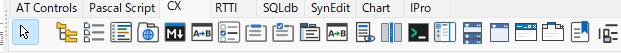

私は、delphi/lazarusが大好きで、いつも利用しています。ただ日本では、ほぼだれもlazarusを知らないし、利用している人が殆どいません。使いたいツールを探しても日本にはありません。仕方がないので、自分で作成して利用しています。
ここに上げたのは、Lazarus（Free Pascal）用の部品集です。フォームに置くだけで、エクスプローラーと同じファイル操作、タブ付きブラウザ、タブ付きエディタ（Monaco・SynEdit）、Markdown のプレビュー、ブックマーク管理などが使えます。まだWindows版しかありません。ニーズあったらLinux版も作成してみたいと思います。使い方は、Usageを参照して下さい。中の仕組みは、Designに記載しています。興味があるかたは見て下さい。英語が苦手なので、コードのコメントは日本語のままです。

作者: aotan083 ／ ライセンス: MIT

[English Documentation](README.md) | [日本語ドキュメント](README.ja.md)

## 部品

| 部品 | 中身 | 取扱説明書 | 設計書 |
|---|---|---|---|
| TCTreeView | エクスプローラーの左側と同じフォルダーのツリー | [Usage](docs/TCTreeView_Usage.md) | [Design](docs/TCTreeView_Design.md) |
| TCListView | エクスプローラーの右側と同じファイルの一覧 | [Usage](docs/TCListView_Usage.md) | [Design](docs/TCListView_Design.md) |
| TCFileTree | 指定したフォルダーを根にして、フォルダーとファイルを 1 本のツリーに並べる（VS Code のエクスプローラーのように使える。TCListView は不要。TCMonacoEditor・TCsEditor・TCTabBrowser とつなぐだけで、ダブルクリックや右クリックで開ける） | [Usage](docs/TCFileTree_Usage.md) | [Design](docs/TCFileTree_Design.md) |
| TCSynEdit | TSynEdit に、ファイルの読み書き・配色（VS Code のライト・ダークを含む）・拡張子に合わせた色分け（Markdown を含む）・右クリックメニューを足したエディタ | [Usage](docs/TCSynEdit_Usage.md) | [Design](docs/TCSynEdit_Design.md) |
| TCCheckListBox | チェックを 1 つだけにできる TCheckListBox | [Usage](docs/TCCheckListBox_Usage.md) | [Design](docs/TCCheckListBox_Design.md) |
| TCGroupBox・TCCheckGroupBox | 中の部品が消えないグループボックスと、チェック付きの見出しのグループボックス | [Usage](docs/TCGroupBox_Usage.md) | [Design](docs/TCGroupBox_Design.md) |
| TCSideBar | Edge のようなアイコン列と開閉するパネル | [Usage](docs/TCSideBar_Usage.md) | [Design](docs/TCSideBar_Design.md) |
| TCExpandPanel・TCRollout | VS Code のエクスプローラーのような、タイトルバー付きの伸縮するパネル（上下左右・複数並べる・アニメーション・右側にボタンとメニュー・境界のドラッグで大きさを変える） | [Usage](docs/TCExpandPanel_Usage.md) | [Design](docs/TCExpandPanel_Design.md) |
| TCSplitter | マウスを乗せたとき・ドラッグ中に青い線が出る分割線（TSplitter と同じ使い方。色・カーソルを指定できる） | [Usage](docs/TCSplitter_Usage.md) | [Design](docs/TCSplitter_Design.md) |
| TCPageControl・TCTitleBar | ブラウザのようなタブと、タブを並べられるタイトルバー | [Usage](docs/TCPageControl_Usage.md) | [Design](docs/TCPageControl_Design.md) |
| TCTabBrowser | WebView2 を使ったタブ付きの Web ブラウザ | [Usage](docs/TCTabBrowser_Usage.md) | [Design](docs/TCTabBrowser_Design.md) |
| TCMonacoEditor・TCMFindDialog | WebView2 と Monaco Editor によるエディタ（タブ・プレビュー・検索・印刷を内蔵）と、標準アクション 25 個 | [Usage](docs/TCMonacoEditor_Usage.md) | [Design](docs/TCMonacoEditor_Design.md) |
| TCsEditor・TCsFindDialog | TCSynEdit をタブで複数持つエディタ。使い方は TCMonacoEditor と同じ（検索・置換ダイアログ・ミニマップ・タブの分離を含む）。標準アクション 25 個 | [Usage](docs/TCsEditor_Usage.md) | [Design](docs/TCsEditor_Design.md) |
| TCPreview | TCsEditor のプレビュー（Markdown・コード）と印刷（PDF 保存）。エディタとは別の場所に置き、複数のエディタで共有できる | [Usage](docs/TCPreview_Usage.md) | [Design](docs/TCPreview_Design.md) |
| TCcmd | フォームの中のコマンドプロンプト（cmd.exe・PowerShell・ssh・vi などをエミレート。リダイレクト・パイプが使える。ログ・コマンド履歴のファイル保存、`RunCapture` でコマンドの結果の取得） | [Usage](docs/TCcmd_Usage.md) | [Design](docs/TCcmd_Design.md) |
| TCBookmark | Firefox のようなブックマーク管理（TCTabBrowser・TCMonacoEditor で開く） | [Usage](docs/TCBookmark_Usage.md) | [Design](docs/TCBookmark_Design.md) |
| CXLang（日英切り替え） | すべての部品の画面の文字（メニュー・ボタン・メッセージ）を、日本語と英語で切り替える。WebView2.ini の `[CX]` の `Language` で指定する（使い方は各部品の取扱説明書の 2章） | ― | [Design](docs/CXLang_Design.md) |

---
すべての部品は、パレット [CX] に出ます。


---
## 動作環境

| 項目 | 内容 |
|---|---|
| Lazarus | 5.0 以降（TCSynEdit・TCsEditor・TCPreview）。ほかの部品は 4.8 でも動く |
| FPC | 3.2.2 |
| OS | Windows 11（64 ビット） |

## フォルダー

| フォルダー | 中身 |
|---|---|
| `packages` | パッケージ `cx.lpk`（実行時。部品の中身すべて）と `cxdsgn.lpk`（設計時。パレットへの登録・アイコン） |
| `source` | 部品のソース（実行時） |
| `source\design` | 設計時のソース（パレットへの登録・コンポーネントエディタ） |
| `source\res` | パレットのアイコン（.lrs） |
| `docs` | 部品ごとの取扱説明書（`*_Usage.md`）と設計書（`*_Design.md`）、日英切り替えの設計書（`CXLang_Design.md`）。英語版は `docs\en` |
| `runtime` | WebView2 の部品が実行時に使うファイル（`monaco`・`preview`） |
| `demo` | 部品ごとのサンプル |

## インストール

1. 先に、次のパッケージを Lazarus に入れる。
   - WebView4Delphi の Lazarus 用パッケージ（https://github.com/salvadordf/WebView4Delphi）
   - ATFlatControls（`atflatcontrols_package`。オンラインパッケージマネージャーから入れる）
   - SynEdit は Lazarus に最初から入っている
2. `packages\cx.lpk` を開き、「コンパイル」する。
3. `packages\cxdsgn.lpk` を開き、「インストール」する（IDE が作り直される）。
4. 再起動後、パレット [CX] に部品が出る。

## アプリで使う

- 部品をフォームに置くと、プロジェクトの必要パッケージに `cx` が自動で追加される（`cxdsgn` はアプリには要らない）。
- .lpr には何も書かない。

TCTabBrowser・TCMonacoEditor・TCBookmark・TCPreview・TCcmd を使うアプリは、EXE と同じフォルダーに次のファイルを置く。

| ファイル | 中身 |
|---|---|
| `WebView2.ini` | 必ず置く。キーの値は空でもよい（空なら EXE のフォルダーの既定の場所を使う） |
| `WebView2Loader.dll` | 64 ビット版。WebView4Delphi のリポジトリから入手する |
| `monaco\` | TCMonacoEditor のエディタ（TCMonacoEditor だけ。`runtime\monaco`。`vs` は npm の `monaco-editor` の `min\vs`） |
| `preview\` | TCMonacoEditor・TCPreview のプレビュー（`runtime\preview`） |
| `terminal\` | TCcmd の画面（`runtime\terminal`） |

```ini
[WebView2]
LoaderDllPath=
UserDataFolder=
MonacoFolder=
PreviewFolder=
TerminalFolder=

[CX]
Language=
```

| キー | 中身 | 空のとき |
|---|---|---|
| `LoaderDllPath` | WebView2Loader.dll のファイル | EXE のフォルダーの WebView2Loader.dll |
| `UserDataFolder` | WebView2 のユーザーデータのフォルダー | EXE のフォルダー\WebView2Data |
| `MonacoFolder` | `editor.html` と `vs` があるフォルダー | EXE のフォルダー\monaco |
| `PreviewFolder` | `preview.html` と `lib` があるフォルダー | EXE のフォルダー\preview |
| `TerminalFolder` | `terminal.html` と `lib` があるフォルダー（TCcmd） | EXE のフォルダー\terminal |
| `Language`（`[CX]`） | 画面の言語 `ja`・`en` | Windows の表示言語（日本語なら `ja`、それ以外は `en`） |

- 値の中の `%名前%` は、同じ `[WebView2]` のキー、なければ Windows の環境変数で置き換える。たとえば `CXROOT=C:\CX\runtime` と書いて、`TerminalFolder=%CXROOT%\terminal` とする。見つからない名前は、そのまま残る。
- 相対パスは EXE のフォルダーから数える。複数のアプリで 1 か所の `monaco`・`preview` を使うこともできる（[TCMonacoEditor の取扱説明書](docs/TCMonacoEditor_Usage.md)）。
- 実行には Microsoft Edge WebView2 ランタイム（Windows 11 には最初から入っている）が要る。
- TCsEditor だけなら、実行時のファイルは要らない。TCPreview を使うときだけ置く。

### 画面の言語（日本語・English）

すべての部品の画面の文字（メニュー・ボタン・メッセージ）は、日本語か英語で出る。言語は、EXE と同じフォルダーの `WebView2.ini` の `[CX]` の `Language` で決める（`ja`・`en`）。書かないときは Windows の表示言語に合わせる。

```ini
[CX]
Language=en
```

- WebView2 を使わないアプリでも、言語を指定するときは `WebView2.ini` を置く（`[CX]` だけを書けばよい）。
- 起動してから最初に文字を出すときに 1 回だけ読む。くわしくは各部品の取扱説明書の 2章と [CXLang の設計書](docs/CXLang_Design.md)。

## ライセンス

MIT ライセンス（[LICENSE](LICENSE)）。外部のライブラリのライセンスは [THIRD_PARTY_NOTICES.md](THIRD_PARTY_NOTICES.md) にある。

---

> ⚡ **1分で構築！コード0行（ノーコード）でアプリにプロ品質のモダンUIを標準搭載**  
> フォームに配置してプロパティを繋ぐだけ。タブの切り離し（Tear-off）、Drag & Drop、完全なWindows Explorer機能、Markdown/Mermaidプレビューなどが、**Pascalコードを1行も書かずに**動作します。

---

## ⚡ なぜ CXComponents なのか？（RAD体験の革命）

従来のLazarus開発では、Windows Explorer同等のファイル操作やVS Code風のタブ切り離し、Markdownプレビューなどを実現するために、**数千行の複雑なコードやShell API呼び出しをガリガリ書く必要**がありました。

**CXComponents** は、すべての実体処理・イベントハンドラ・標準アクションをコンポーネント内部に完全内蔵しています。そのため、**「配置してプロパティを繋ぐだけ」の完全ノーコード**で、プロ仕様のモダンアプリケーションを即座に構築できます。

### 📊 開発効率の対比（Before / After）

| 機能・動作 | 従来のLazarus開発 | CXComponents（ノーコード） |
| :--- | :--- | :--- |
| **Windows Explorer同等のファイル操作** | Shell API呼び出し、D&D、移動/コピー処理を数千行自作 | **コード0行**（`TCTreeView` / `TCListView` を貼るだけ） |
| **タブの分離・ドッキング（Tear-off / Tear-on）** | フォーム生成、イベントハンドラ、ドッキング処理を自作 | **コード0行**（`TCSEditor` / `TCMonacoEditor` で標準動作） |
| **26言語ハイライト対応エディタ** | SynEditの個別設定やエンコーディング判別コードを記述 | **コード0行**（`TCSynEdit` / `TCSEditor` を置くだけ） |
| **Markdown & Mermaid図プレビュー** | 外部描画エンジンの組み込み・同期スクロールコードの記述 | **コード0行**（`TCPreview` を配置するだけ） |
| **WebView2ベース タブブラウザ** | WebView呼び出し、ソース取得、PDF出力処理を実装 | **コード0行**（`TCTabBrowser` を配置するだけ） |
| **タイトルバー一体型タブ & サイドバー** | ウィンドウ非クライアント領域の複雑な自作描画 | **コード0行**（`TCTitleBar` + `TCSideBar` を配置するだけ） |

---

## ⚡ 1分でわかる！ノーコードで搭載できる機能一覧

```pascal
// 【実装コード例：0 Lines】
// Pascalコードの記述は一切不要です！
// フォームにコンポーネントを配置し、オブジェクトインスペクタで接続するだけで全機能が動作します。
```

---

### 📂 ファイル・フォルダ操作コンポーネント

#### `TCTreeView` / `TCListView`
* **見た目も動作も、完全に Windows Explorer そのもの！**
* ファイルのコピー、移動、削除、新規作成、名前変更などの**実体処理を完全内蔵**。
* エクスプローラー左ペイン（ナビゲーションウィンドウ）＆右クリックコンテキストメニュー（「新規作成」「送る」等）にフル対応。
* デスクトップや他アプリからの **Drag & Drop**、ショートカット作成、アプリ関連付けに標準対応。
* Windows Theme（ダークモード/ライトモード）に完全追従。
* ⚡ **ノーコード効果**: フォームに貼るだけで、本格的なエクスプローラー機能があなたのアプリの標準機能になります。

---

### 📝 テキスト・コードエディタコンポーネント

#### `TCSynEdit`
* フォームに貼るだけで、**新規作成 / 名前を付けて保存 / 上書き保存チェック / 検索・置換** が即座に利用可能。
* 拡張子を自動判別し、**26種類のプログラミング言語・ファイル形式の構文ハイライト**に対応。
* **Markdown標準対応**、文字エンコーディング・BOMの自動判別。
* ズームイン・ズームアウト、更新箇所表示、Undo/Redo、折りたたみ・折り返し対応。
* Windows Explorerからの Drag & Drop、Windows Theme にフル対応。
* ⚡ **ノーコード効果**: 1行もコードを書かずに、プロ仕様の単体コードエディタが完成します。

#### `TCSEditor`
* `TCSynEdit` の全機能を備えた**マルチタブエディタ**。
* **Tear-off（タブ切り離し）/ Tear-on（ドッキング）**をコード0行で実現。
* `TCPreview` と連動したリアルタイムプレビュー対応。
* シングルエディタ / タブエディタの動的切り替え、タブのドラッグ移動・破棄・独自ポップアップメニュー追加に対応。
* `TCMonacoEditor` とイベント・プロパティの**完全互換性**を確保（コンポーネントを張り替えるだけでエディタエンジンの切り替えが可能）。
* ⚡ **ノーコード効果**: 置くだけでタブ型マルチウィンドウエディタがあなたのアプリの標準機能になります。

#### `TCMonacoEditor`
* VS Codeの核である **Monaco Editor** をLazarusアプリに組み込み。
* ミニマップ表示、Markdownプレビュー、プレビューからの**PDF印刷**に対応。
* シングル/タブ切り替え、**Tear-off / Tear-on**、新規作成・開く・全ファイル一括保存・エンコード自動判別。
* 行単位のワード編集・分割、検索・置換、Undo/Redo、クリップボード操作、**F1キーでのコマンドパレット起動**に対応。
* Windows Explorerからの Drag & Drop、Windows Theme にフル対応。
* ⚡ **ノーコード効果**: コード0行で本物のVS Code開発環境をアプリ内に再現できます。

---

### 🌐 ブラウザ & プレビューコンポーネント

#### `TCTabBrowser`
* WebView2ベースの**モダンタブブラウザ**。
* 表示中ページのHTMLソース取得、ファイル保存・読み込み機能。
* タブのドラッグ移動・破棄、右クリックポップアップメニューの独自カスタマイズ。
* **画面キャプチャ保存**機能、**PDF化保存**機能を内蔵。
* 外部JavaScriptの流し込み・実行、完了復帰時のページ切り替えに対応。
* Windows Theme にフル対応。
* ⚡ **ノーコード効果**: コード0行で高機能なWebブラウザ環境をアプリに統合できます。

#### `TCPreview`
* **Markdown & Mermaid図**に完全対応した高性能プレビューエンジン。
* **対応Mermaid図（11種類）**: フローチャート（上下/左右）、シーケンス図、ユースケース図、クラス図、ER図、Gitグラフ、ユーザージャーニー、XYグラフ（棒・折れ線）、象限図、アーキテクチャ図。
* 拡大・縮小、同期スクロール＆スクロール幅調整、外部URL画像取得のON/OFF制御。
* **PDF印刷・出力**に対応。Windows Theme にフル対応。
* ⚡ **ノーコード効果**: コード0行でドキュメントや図形のインタラクティブなプレビュー環境を実現します。

#### `TCcmd`
* **フォームの中で動くコマンドプロンプト**。cmd.exe・PowerShell・ssh・vi・python などエミレート（色・カーソル・全角・選択・検索）します。
* リダイレクト（`>`・`2>&1`）とパイプ（`|`）は cmd.exe と同じように動く。コンソールの窓は出ない。
* 出力のログとコマンド履歴をファイルに保存。`RunCapture` で、コマンドの標準出力・エラー出力・終了コードを別々に受け取れる。
* フォント・色・ライト/ダークの配色・カーソル・保持する行数を、オブジェクトインスペクタで設定できる。
* ⚡ **ノーコード効果**: 置くだけで、アプリにコマンドプロンプトが付く。

---

### ⚡ UIレイアウト・ナビゲーションコンポーネント

#### `TCSideBar`
* VS Codeスタイルの**ナビゲーションサイドバー**を即座に構築。
* 表示・非表示切り替え、表示幅の可変変更など、サイドバーに必要な全機能を標準装備。
* Windows Theme にフル対応。
* ⚡ **ノーコード効果**: 貼るだけでプロフェッショナルなサイドバーレイアウトが完成します。

#### `TCExpandPanel`
* アコーディオンのように**伸縮・折りたたみが可能なPanel**。
* パネルの間の境界を**マウスでドラッグして大きさを変更**（実行時・設計時）。開いている最後のパネルが、余った場所を自動で埋める。
* Windows Theme にフル対応。

#### `TCSplitter`
* 標準 `TSplitter` と同じ使い方で、**マウスを乗せたとき・ドラッグ中に青い線が出る**分割線。線の色（`HighlightColor`）とカーソル（`SplitCursor`）を指定でき、`OnMouseEnter`・`OnMouseLeave` も使える。

#### `TCTitleBar` + `TCPageControl`
* ウィンドウの**タイトルバー上にタブを直接配置**。
* タイトルバー内にポップアップメニュー、アイコン、スピードボタンを直接搭載可能。
* タブの移動・削除・タイトル変更・スクロール表示に対応。
* Windows Theme にフル対応。
* ⚡ **ノーコード効果**: ChromeやEdgeのようなタイトルバー一体型タブUIがコード0行で実現します。

---

### 🛠 拡張標準コントロール

#### `TCCheckListBox`
* シングルライン / マルチライン選択に対応。Windows Theme にフル対応。

#### `TCGroupBox`
* 標準 `TGroupBox` の描画不具合を改善した高品質バージョン。Windows Theme にフル対応。

#### `TCCheckGroupBox`
* GroupBoxとCheckBoxが一体化。チェック状態に応じて**子コントロールの活性/非活性をコード0行で自動連動**。
* Windows Theme にフル対応。


---
* デモアプリのキャプチャー画像


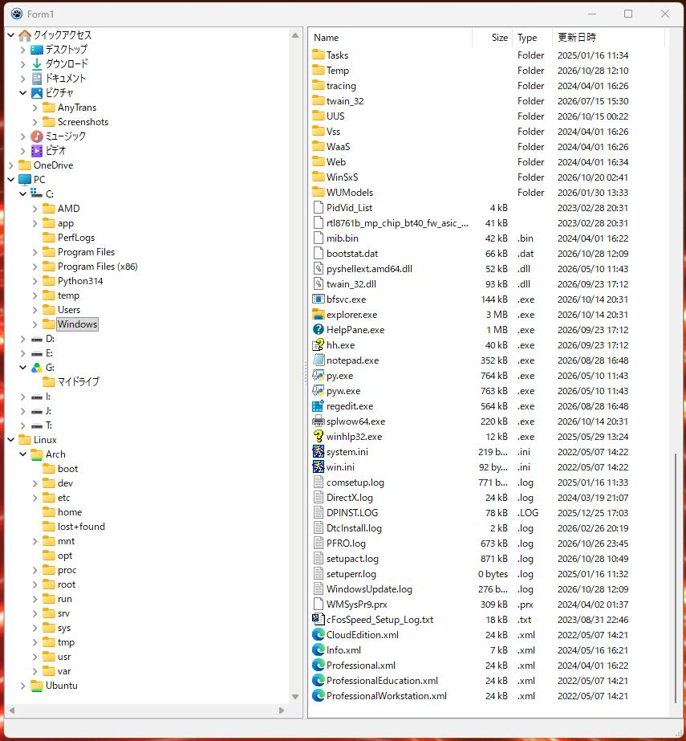

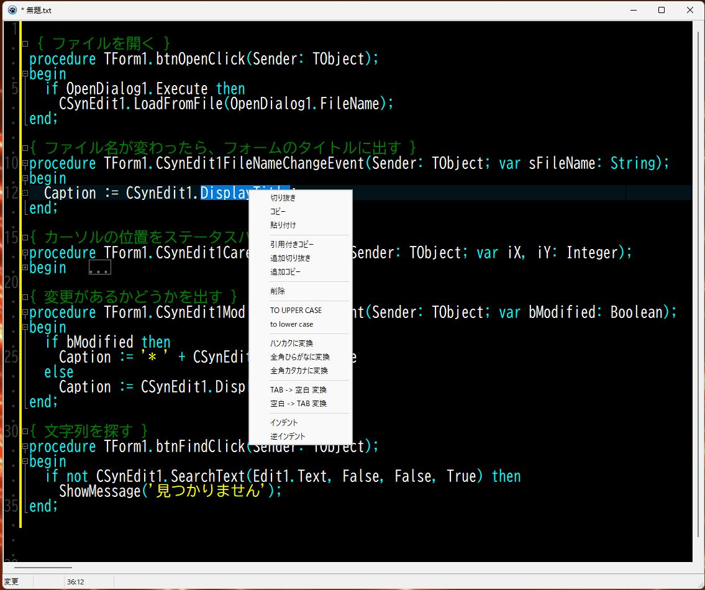

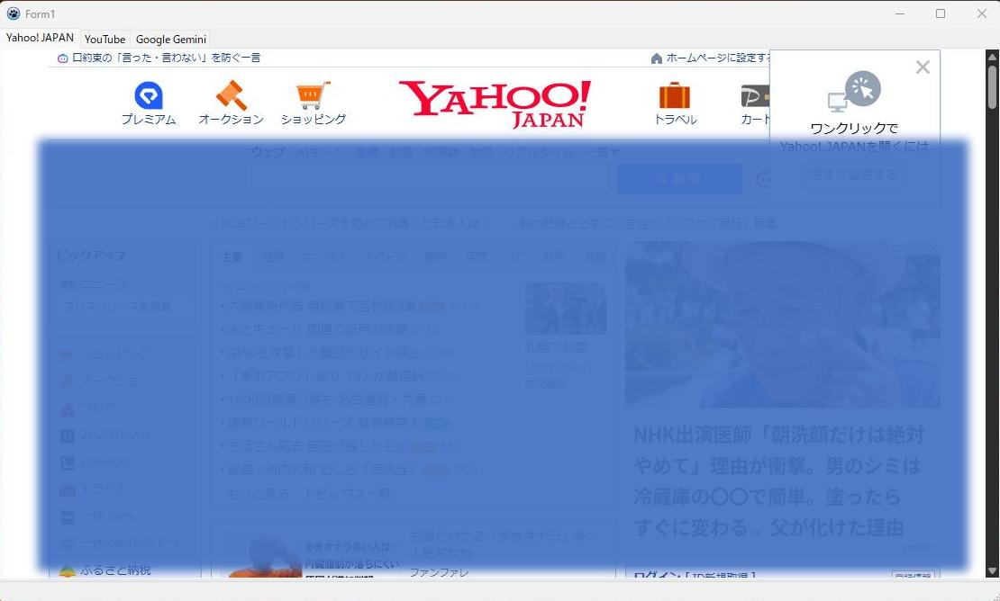

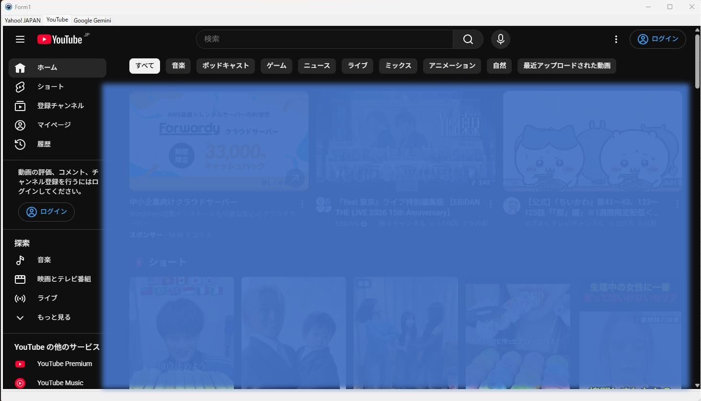

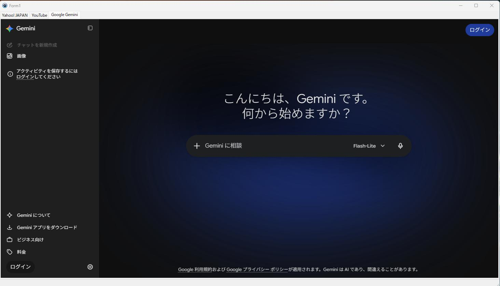

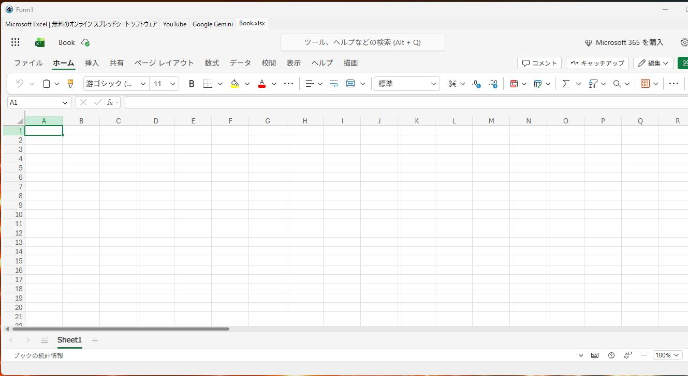

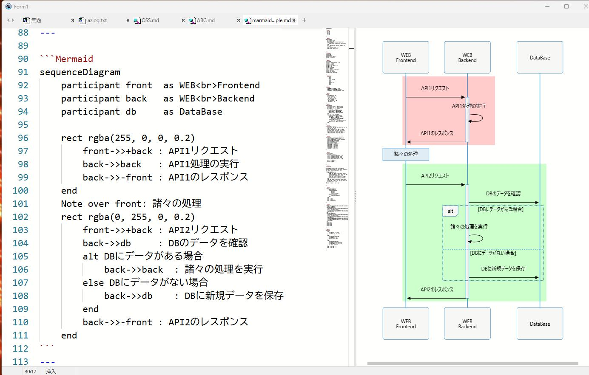

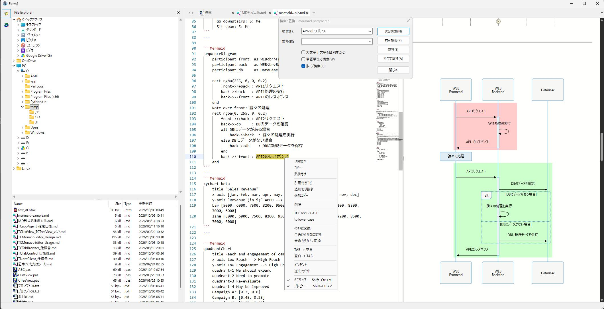

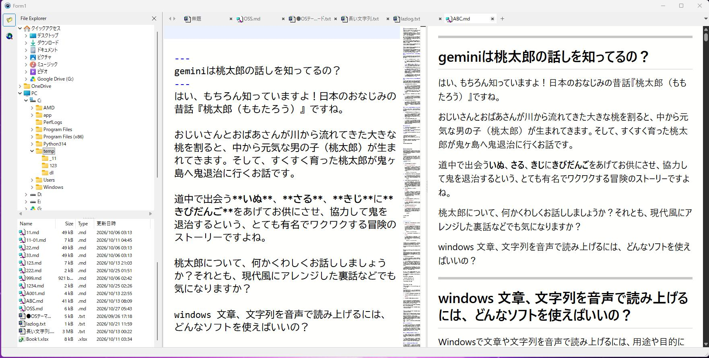

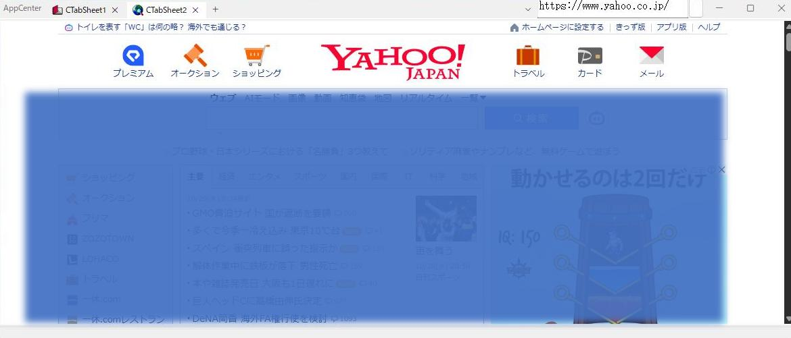

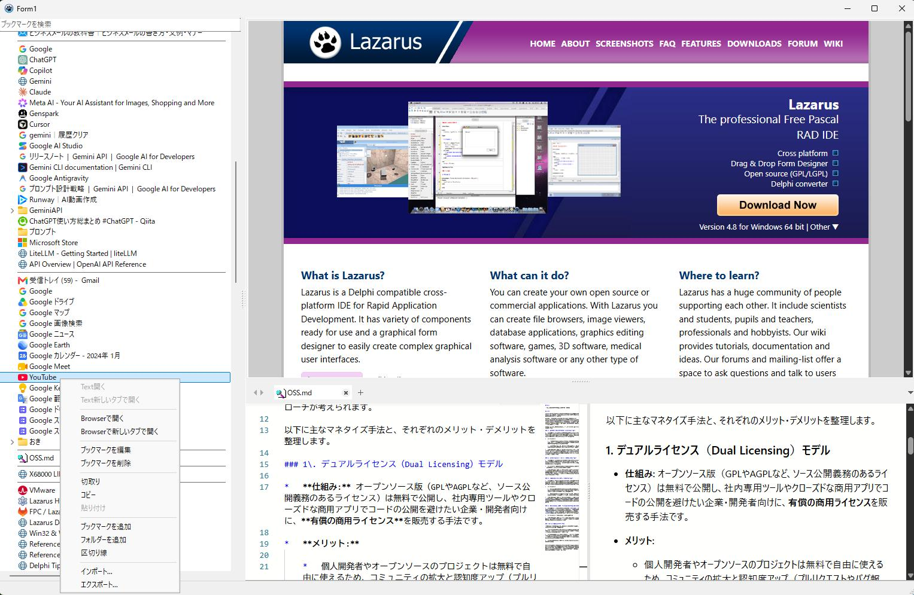

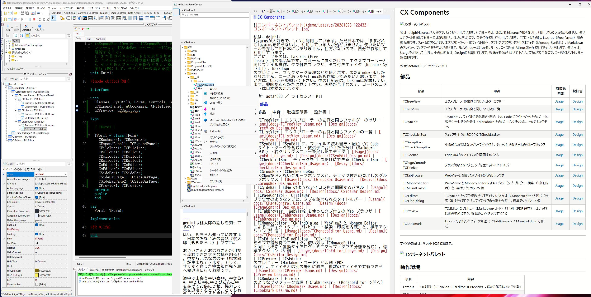

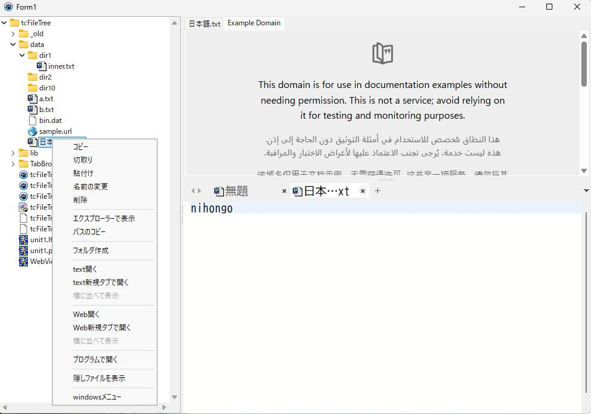

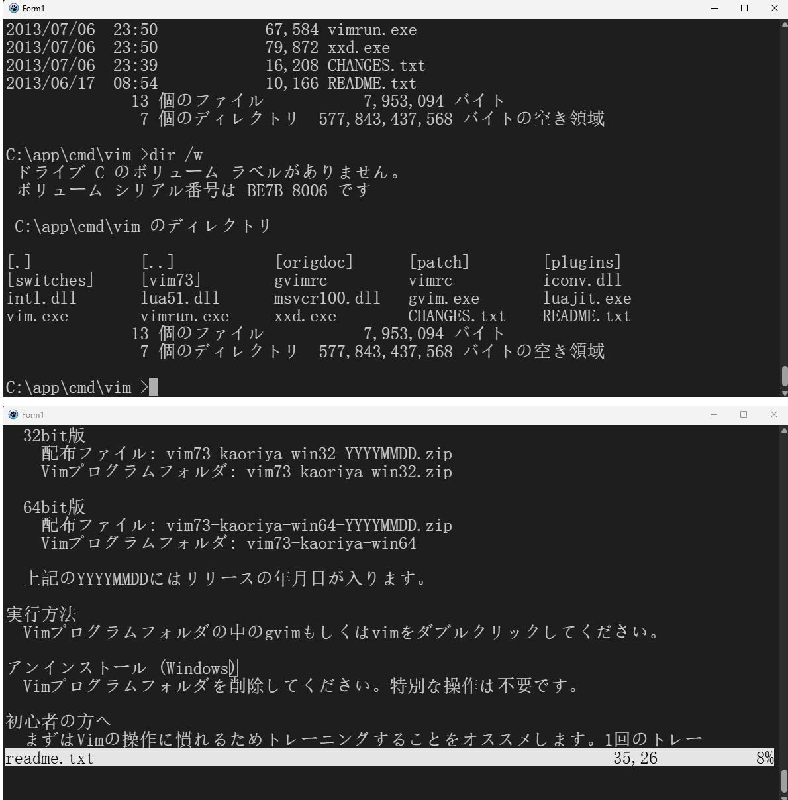


---
