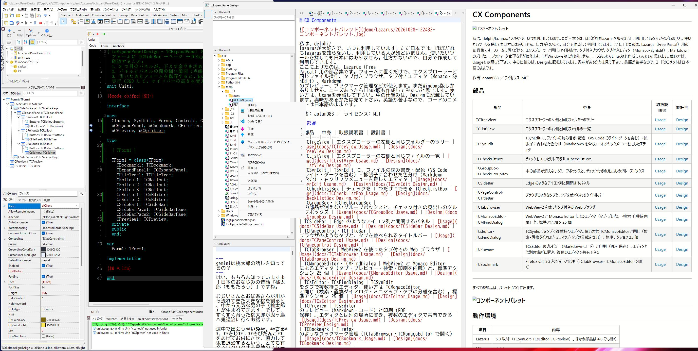
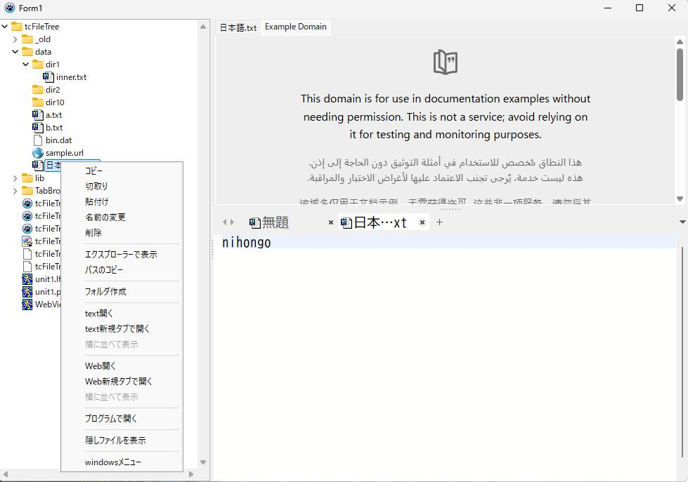

# CX Components


I love Delphi and Lazarus and use them all the time. However, in Japan almost nobody knows Lazarus, and very few people use it. When I looked for the tools I wanted, I couldn't find them in Japan. So I built them myself and use them.
This is a set of components for Lazarus (Free Pascal). Just place them on a form and you can use Explorer-style file operations, a tabbed browser, a tabbed editor (Monaco and SynEdit), Markdown preview, bookmark management, and more. Currently there is only a Windows version. If there is demand, I would like to create a Linux version as well. For usage, please see the Usage documents. For how the internals work, see the Design documents. If you are interested, please take a look. My English is weak, so the comments in the code are still in Japanese.

Author: aotan083 / License: MIT

[English Documentation](README.md) | [日本語ドキュメント](README.ja.md)

## Components

| Component | Contents | Usage | Design |
|---|---|---|---|
| TCTreeView | The same folder tree as the left side of Explorer | [Usage](docs/TCTreeView_Usage.md) | [Design](docs/TCTreeView_Design.md) |
| TCListView | The same file list as the right side of Explorer | [Usage](docs/TCListView_Usage.md) | [Design](docs/TCListView_Design.md) |
| TCFileTree | Shows folders and files in a single tree rooted at a specified folder (usable like the VS Code Explorer; TCListView is not needed. Just connect it to TCMonacoEditor, TCsEditor, or TCTabBrowser, and you can open files by double-clicking or from the right-click menu) | [Usage](docs/TCFileTree_Usage.md) | [Design](docs/TCFileTree_Design.md) |
| TCSynEdit | An editor that adds file read/write, color schemes (including VS Code light and dark), syntax coloring by file extension (including Markdown), and a right-click menu to TSynEdit | [Usage](docs/TCSynEdit_Usage.md) | [Design](docs/TCSynEdit_Design.md) |
| TCCheckListBox | A TCheckListBox that allows only one check at a time | [Usage](docs/TCCheckListBox_Usage.md) | [Design](docs/TCCheckListBox_Design.md) |
| TCGroupBox / TCCheckGroupBox | A group box whose child controls do not disappear, and a group box with a checkbox in its caption | [Usage](docs/TCGroupBox_Usage.md) | [Design](docs/TCGroupBox_Design.md) |
| TCSideBar | An icon column like Edge's and a panel that opens and closes | [Usage](docs/TCSideBar_Usage.md) | [Design](docs/TCSideBar_Design.md) |
| TCExpandPanel / TCRollout | Expandable panels with title bars, like the VS Code Explorer (top, bottom, left, right; multiple panels can be stacked; animation; buttons and a menu on the right side) | [Usage](docs/TCExpandPanel_Usage.md) | [Design](docs/TCExpandPanel_Design.md) |
| TCPageControl / TCTitleBar | Browser-style tabs, and a title bar where tabs can be arranged | [Usage](docs/TCPageControl_Usage.md) | [Design](docs/TCPageControl_Design.md) |
| TCTabBrowser | A tabbed web browser using WebView2 | [Usage](docs/TCTabBrowser_Usage.md) | [Design](docs/TCTabBrowser_Design.md) |
| TCMonacoEditor / TCMFindDialog | An editor based on WebView2 and Monaco Editor (with built-in tabs, preview, search, and printing), and 25 standard actions | [Usage](docs/TCMonacoEditor_Usage.md) | [Design](docs/TCMonacoEditor_Design.md) |
| TCsEditor / TCsFindDialog | An editor that holds multiple TCSynEdit instances in tabs. Usage is the same as TCMonacoEditor (including search and replace dialogs, minimap, and detachable tabs). 25 standard actions | [Usage](docs/TCsEditor_Usage.md) | [Design](docs/TCsEditor_Design.md) |
| TCPreview | Preview (Markdown and code) and printing (save as PDF) for TCsEditor. Placed separately from the editor, and can be shared by multiple editors | [Usage](docs/TCPreview_Usage.md) | [Design](docs/TCPreview_Design.md) |
| TCBookmark | Bookmark management like Firefox's (opens links in TCTabBrowser or TCMonacoEditor) | [Usage](docs/TCBookmark_Usage.md) | [Design](docs/TCBookmark_Design.md) |
| CXLang (Japanese/English switching) | Switches all on-screen text of every component (menus, buttons, messages) between Japanese and English. Specified by `Language` in `[CX]` of WebView2.ini (see Chapter 2 of each component's Usage document) | ― | [Design](docs/CXLang_Design.md) |

---
All components appear in the palette [CX].


---
## Requirements

| Item | Details |
|---|---|
| Lazarus | 5.0 or later (TCSynEdit, TCsEditor, TCPreview). Other components also work with 4.8 |
| FPC | 3.2.2 |
| OS | Windows 11 (64-bit) |

## Folders

| Folder | Contents |
|---|---|
| `packages` | Package `cx.lpk` (runtime; all component contents) and `cxdsgn.lpk` (design time; palette registration and icons) |
| `source` | Component source code (runtime) |
| `source\design` | Design-time source (palette registration and component editors) |
| `source\res` | Palette icons (.lrs) |
| `docs` | Usage (`*_Usage.md`) and design (`*_Design.md`) documents for each component, plus the Japanese/English switching design document (`CXLang_Design.md`). English versions are in `docs\en` |
| `runtime` | Files the WebView2 components use at runtime (`monaco` and `preview`) |
| `demo` | Sample apps for each component |

## Installation

1. First, install the following packages into Lazarus.
   - The Lazarus package for WebView4Delphi (https://github.com/salvadordf/WebView4Delphi)
   - ATFlatControls (`atflatcontrols_package`; install from the Online Package Manager)
   - SynEdit is already included with Lazarus
2. Open `packages\cx.lpk` and "Compile" it.
3. Open `packages\cxdsgn.lpk` and "Install" it (the IDE will be rebuilt).
4. After restarting, the components appear in the palette [CX].

## Using in an application

- When you place a component on a form, `cx` is automatically added to the project's required packages (`cxdsgn` is not needed in the application).
- Nothing needs to be written in the .lpr.

Applications that use TCTabBrowser, TCMonacoEditor, TCBookmark, or TCPreview need the following files in the same folder as the EXE.

| File | Contents |
|---|---|
| `WebView2.ini` | Always required. The key values may be empty (if empty, the default location in the EXE's folder is used) |
| `WebView2Loader.dll` | 64-bit version. Obtain it from the WebView4Delphi repository |
| `monaco\` | The TCMonacoEditor editor (only for TCMonacoEditor; `runtime\monaco`. `vs` is `min\vs` from the npm `monaco-editor` package) |
| `preview\` | The preview for TCMonacoEditor and TCPreview (`runtime\preview`) |

```ini
[WebView2]
LoaderDllPath=
UserDataFolder=
MonacoFolder=
PreviewFolder=

[CX]
Language=
```

| Key | Contents | When empty |
|---|---|---|
| `LoaderDllPath` | File path of WebView2Loader.dll | WebView2Loader.dll in the EXE's folder |
| `UserDataFolder` | WebView2 user data folder | EXE's folder\WebView2Data |
| `MonacoFolder` | Folder containing `editor.html` and `vs` | EXE's folder\monaco |
| `PreviewFolder` | Folder containing `preview.html` and `lib` | EXE's folder\preview |
| `Language` (`[CX]`) | Display language `ja` or `en` | Windows display language (`ja` if Japanese, otherwise `en`) |

- Relative paths are counted from the EXE's folder. Multiple applications can share one `monaco` and `preview` folder (see the [TCMonacoEditor Usage document](docs/TCMonacoEditor_Usage.md)).
- Running requires the Microsoft Edge WebView2 Runtime (already included in Windows 11).
- If you use only TCsEditor, the runtime files are not needed. Place them only when using TCPreview.

### Display language (Japanese / English)

All on-screen text of every component (menus, buttons, messages) is shown in Japanese or English. The language is set by `Language` in `[CX]` of `WebView2.ini` in the same folder as the EXE (`ja` or `en`). If not specified, it follows the Windows display language.

```ini
[CX]
Language=en
```

- Even for applications that do not use WebView2, place `WebView2.ini` when specifying the language (only `[CX]` needs to be written).
- It is read only once, when text is first displayed after startup. For details, see Chapter 2 of each component's Usage document and the [CXLang Design document](docs/CXLang_Design.md).

## License

MIT License ([LICENSE](LICENSE)). The licenses of external libraries are listed in [THIRD_PARTY_NOTICES.md](THIRD_PARTY_NOTICES.md).

---

> ⚡ **Built in 1 minute! Zero lines of code (no-code) gives your app professional-quality modern UI as standard**  
> Just place it on a form and connect the properties. Tear-off tabs, Drag & Drop, full Windows Explorer features, Markdown/Mermaid preview, and more work **without writing a single line of Pascal code**.

---

## 🚀 Why CX Components? (A RAD revolution)

In traditional Lazarus development, to implement Explorer-equivalent file operations, VS Code-style tab tear-off, Markdown preview, and so on, you had to **laboriously write thousands of lines of complex code and Shell API calls**.

**CX Components** fully embeds all the core processing, event handlers, and standard actions inside the components. As a result, you can build professional-grade modern applications immediately with **fully no-code development: just place them and connect the properties**.

### 📊 Development efficiency comparison (Before / After)

| Feature / Behavior | Traditional Lazarus development | CX Components (no-code) |
| :--- | :--- | :--- |
| **Explorer-equivalent file operations** | Shell API calls, D&D, and move/copy processing written by hand over thousands of lines | **0 lines of code** (just place `TCTreeView` / `TCListView`) |
| **Tab tear-off / docking (Tear-off / Tear-on)** | Form creation, event handlers, and docking logic written by hand | **0 lines of code** (standard behavior with `TCSEditor` / `TCMonacoEditor`) |
| **Editor with syntax highlighting for 26 languages** | Individual SynEdit settings and encoding detection code | **0 lines of code** (just place `TCSynEdit` / `TCSEditor`) |
| **Markdown & Mermaid diagram preview** | Embedding an external rendering engine and writing scroll-sync code | **0 lines of code** (just place `TCPreview`) |
| **WebView2-based tabbed browser** | WebView calls, source retrieval, and PDF output processing implemented by hand | **0 lines of code** (just place `TCTabBrowser`) |
| **Title-bar-integrated tabs & sidebar** | Complex custom drawing of the non-client area of the window | **0 lines of code** (just place `TCTitleBar` + `TCSideBar`) |

---

## ⚡ Features you can add with no code, at a glance

```pascal
// [Implementation code example: 0 Lines]
// No Pascal code at all!
// Place components on a form and connect them in the Object Inspector, and all features work.
```

---

### 📂 File and folder components

#### `TCTreeView` / `TCListView`
* **Looks and behaves exactly like Windows Explorer!**
* **Fully built-in processing** for copy, move, delete, create new, rename, and so on.
* Full support for the Explorer left pane (navigation window) and right-click context menu (such as "New" and "Send to").
* Standard support for **Drag & Drop** from the desktop or other applications, shortcut creation, and file associations.
* Fully follows the Windows theme (dark mode / light mode).
* ⚡ **No-code effect**: Just place it on a form, and a full-featured Explorer becomes a standard feature of your app.

---

### 📝 Text and code editor components

#### `TCSynEdit`
* Just place it on a form, and **New / Save As / overwrite-save check / search and replace** are immediately available.
* Automatically detects the file extension and supports **syntax highlighting for 26 programming languages and file formats**.
* **Standard Markdown support**, with automatic detection of character encoding and BOM.
* Zoom in and out, change-location display, Undo/Redo, code folding, and word wrap.
* Full support for Drag & Drop from Windows Explorer and the Windows theme.
* ⚡ **No-code effect**: A professional standalone code editor is complete without writing a single line of code.

#### `TCSEditor`
* A **multi-tab editor** with all the features of `TCSynEdit`.
* **Tear-off (detaching tabs) / Tear-on (docking)** achieved with 0 lines of code.
* Real-time preview linked with `TCPreview`.
* Dynamic switching between single-editor and tab-editor modes, tab drag-and-drop reordering, closing, and adding custom popup menu items.
* **Full compatibility** of events and properties with `TCMonacoEditor` (you can switch the editor engine just by swapping the component).
* ⚡ **No-code effect**: Place it and a tab-based multi-window editor becomes a standard feature of your app.

#### `TCMonacoEditor`
* Embeds **Monaco Editor**, the core of VS Code, into Lazarus applications.
* Supports minimap display, Markdown preview, and **PDF printing** from the preview.
* Single/tab switching, **Tear-off / Tear-on**, New / Open / Save All files at once, and automatic encoding detection.
* Supports line-based word editing and splitting, search and replace, Undo/Redo, clipboard operations, and **launching the command palette with the F1 key**.
* Full support for Drag & Drop from Windows Explorer and the Windows theme.
* ⚡ **No-code effect**: With 0 lines of code, you can reproduce a genuine VS Code development environment inside your app.

---

### 🌐 Browser and preview components

#### `TCTabBrowser`
* A **modern tabbed browser** based on WebView2.
* Retrieves the HTML source of the displayed page, and supports saving and loading files.
* Drag-and-drop reordering and closing of tabs, and custom right-click popup menus.
* Built-in **screen capture saving** and **save as PDF** features.
* Injects and runs external JavaScript, and supports page switching when a task completes.
* Full support for the Windows theme.
* ⚡ **No-code effect**: Integrate a full-featured web browser into your app with 0 lines of code.

#### `TCPreview`
* A high-performance preview engine with full support for **Markdown and Mermaid diagrams**.
* **Supported Mermaid diagrams (11 types)**: flowcharts (top-down / left-right), sequence diagrams, use case diagrams, class diagrams, ER diagrams, Git graphs, user journeys, XY charts (bar and line), quadrant charts, and architecture diagrams.
* Zoom in and out, synchronized scrolling and scroll-width adjustment, and ON/OFF control for loading external URL images.
* Supports **PDF printing and output**. Full support for the Windows theme.
* ⚡ **No-code effect**: Interactive preview of documents and diagrams with 0 lines of code.

---

### 🎨 UI layout and navigation components

#### `TCSideBar`
* Instantly builds a **navigation sidebar** in VS Code style.
* Standard support for everything a sidebar needs, including show/hide toggling and variable width.
* Full support for the Windows theme.
* ⚡ **No-code effect**: Just place it, and a professional sidebar layout is complete.

#### `TCExpandPanel`
* A **panel that expands and collapses like an accordion**.
* Full support for the Windows theme.

#### `TCTitleBar` + `TCPageControl`
* **Places tabs directly on the window's title bar**.
* Popup menus, icons, and speed buttons can be placed directly inside the title bar.
* Supports moving and deleting tabs, changing titles, and scrolling display.
* Full support for the Windows theme.
* ⚡ **No-code effect**: A title-bar-integrated tab UI like Chrome or Edge is achieved with 0 lines of code.

---

### 🛠 Extended standard controls

#### `TCCheckListBox`
* Supports single-line and multi-line selection. Full support for the Windows theme.

#### `TCGroupBox`
* An improved, higher-quality version of the standard `TGroupBox` that fixes drawing problems. Full support for the Windows theme.

#### `TCCheckGroupBox`
* A GroupBox and CheckBox combined. **Automatically enables or disables child controls based on the check state with 0 lines of code**.
* Full support for the Windows theme.

---
* Screenshots from the demo app






---
