# CX Components

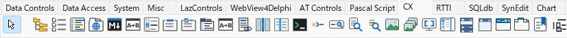

I love Delphi and Lazarus and use them all the time. However, in Japan almost nobody knows Lazarus, and very few people use it. When I looked for the tools I wanted, I couldn't find them in Japan. So I built them myself and use them.
This is a set of components for Lazarus (Free Pascal). Just place them on a form and you can use Explorer-style file operations, a tabbed browser, a tabbed editor (Monaco and SynEdit), Markdown preview, bookmark management, and more. Currently there is only a Windows version. If there is demand, I would like to create a Linux version as well. For usage, please see the Usage documents. For how the internals work, see the Design documents. If you are interested, please take a look. My English is weak, so the comments in the code are still in Japanese.

Author: aotan083 / License: MIT

[English Documentation](README.md) | [日本語ドキュメント](README.ja.md)

* Interactive AI Documentation (Q&A Portal): This AI has learned from all 49 design documents and usage guides in this repository.
* **AI Manual Portal** is now available. You can directly ask the AI ​​questions and search for information about component combinations and property specifications.

[Interactive AI Documentation] (https://notebook.google.com/notebook/56c78d45-c7c5-4f17-9a81-c83314215247)


## Components

| Component | Contents | Usage | Design |
|---|---|---|---|
| TCTreeView | The same folder tree as the left side of Explorer | [Usage](docs/en/TCTreeView_Usage.md) | [Design](docs/en/TCTreeView_Design.md) |
| TCListView | The same file list as the right side of Explorer | [Usage](docs/en/TCListView_Usage.md) | [Design](docs/en/TCListView_Design.md) |
| TCAddressBar | The Explorer address bar (breadcrumbs, a ">" list of the folders below, typing a path, back / forward / up / refresh, recent locations). It works just by connecting it to TCListView and TCTreeView | [Usage](docs/en/TCAddressBar_Usage.md) | [Design](docs/en/TCAddressBar_Design.md) |
| TCSearchBox | The Explorer search box. Press Enter to search a folder by name (contains, wildcard, regular expression) and show the result in TCListView. It works just by connecting it to TCListView and TCTreeView | [Usage](docs/en/TCSearchBox_Usage.md) | [Design](docs/en/TCSearchBox_Design.md) |
| TCFindFile | A non-visual component that searches files and folders by name. It searches in a separate thread and delivers the results little by little. Used by TCSearchBox; it can also be used on its own | [Usage](docs/en/TCFindFile_Usage.md) | [Design](docs/en/TCFindFile_Design.md) |
| TCGrepFile | A non-visual component that searches the files in a folder by the text inside them (grep search). It narrows the files by name (`*.pas;*.lfm`) and searches lines by contains or regular expression. Results are in the form "path(line number): text" and are received with `OnFound` or written to a file. `TagJump` of TCMonacoEditor and TCsEditor jumps to that line | [Usage](docs/en/TCGrepFile_Usage.md) | [Design](docs/en/TCGrepFile_Design.md) |
| TCImage | An image used just like TImage, which handles bmp, jpg, png, svg, tif and ico. It reads and saves by the format of the extension, and can convert the format when saving (bmp to jpg, etc.; svg is read-only) | [Usage](docs/en/TCImage_Usage.md) | [Design](docs/en/TCImage_Design.md) |
| TCImageList | An image list used just like TImageList. Images can be added from image files, a TCImage, or a folder (svg and transparency are supported). It can be used as it is for `Images` of TCPageControl, TCSideBar and others | [Usage](docs/en/TCImage_Usage.md) | [Design](docs/en/TCImage_Design.md) |
| TCCapture | A non-visual component that captures the desktop screen and saves it to an image file. The range is the whole desktop, the active window, or any rectangle. It creates the destination folder if it does not exist | [Usage](docs/en/TCCapture_Usage.md) | [Design](docs/en/TCCapture_Design.md) |
| TCFileTree | Shows folders and files in a single tree rooted at a specified folder (usable like the VS Code Explorer; TCListView is not needed. Just connect it to TCMonacoEditor, TCsEditor, or TCTabBrowser, and you can open files by double-clicking or from the right-click menu) | [Usage](docs/en/TCFileTree_Usage.md) | [Design](docs/en/TCFileTree_Design.md) |
| TCSynEdit | An editor that adds file read/write, color schemes (including VS Code light and dark), syntax coloring by file extension (including Markdown), and a right-click menu to TSynEdit | [Usage](docs/en/TCSynEdit_Usage.md) | [Design](docs/en/TCSynEdit_Design.md) |
| TCCheckListBox | A TCheckListBox that allows only one check at a time | [Usage](docs/en/TCCheckListBox_Usage.md) | [Design](docs/en/TCCheckListBox_Design.md) |
| TCGroupBox / TCCheckGroupBox | A group box whose child controls do not disappear, and a group box with a checkbox in its caption | [Usage](docs/en/TCGroupBox_Usage.md) | [Design](docs/en/TCGroupBox_Design.md) |
| TCSideBar | An icon column like Edge's and a panel that opens and closes | [Usage](docs/en/TCSideBar_Usage.md) | [Design](docs/en/TCSideBar_Design.md) |
| TCExpandPanel / TCRollout | Expandable panels with title bars, like the VS Code Explorer (top, bottom, left, right; multiple panels can be stacked; animation; buttons and a menu on the right side; resize panels by dragging the boundary) | [Usage](docs/en/TCExpandPanel_Usage.md) | [Design](docs/en/TCExpandPanel_Design.md) |
| TCSplitter | A splitter that shows a blue line on hover and while dragging (used like TSplitter; the color and cursor can be set) | [Usage](docs/en/TCSplitter_Usage.md) | [Design](docs/en/TCSplitter_Design.md) |
| TCPairSplitter | A TPairSplitter-style splitter with two sides, where each side can be hidden or shown (hiding one makes the other fill the whole area; showing it restores both). A blue line appears on mouse over and while dragging, and the splitter can also be dragged at design time | [Usage](docs/en/TCPairSplitter_Usage.md) | [Design](docs/en/TCPairSplitter_Design.md) |
| TCPageControl / TCTitleBar | Browser-style tabs, and a title bar where tabs can be arranged | [Usage](docs/en/TCPageControl_Usage.md) | [Design](docs/en/TCPageControl_Design.md) |
| TCTabBar | A tab strip without pages (for example, the tabs of an editor; the application switches the screen) | [Usage](docs/en/TCTabBar_Usage.md) | [Design](docs/en/TCTabBar_Design.md) |
| TCTabBrowser | A tabbed web browser using WebView2 | [Usage](docs/en/TCTabBrowser_Usage.md) | [Design](docs/en/TCTabBrowser_Design.md) |
| TCMonacoEditor / TCMFindDialog | An editor based on WebView2 and Monaco Editor (with built-in tabs, preview, search, and printing), and 25 standard actions | [Usage](docs/en/TCMonacoEditor_Usage.md) | [Design](docs/en/TCMonacoEditor_Design.md) |
| TCsEditor / TCsFindDialog | An editor that holds multiple TCSynEdit instances in tabs. Usage is the same as TCMonacoEditor (including search and replace dialogs, minimap, and detachable tabs). 25 standard actions | [Usage](docs/en/TCsEditor_Usage.md) | [Design](docs/en/TCsEditor_Design.md) |
| TCPreview | Preview (Markdown and code) and printing (save as PDF) for TCsEditor. Placed separately from the editor, and can be shared by multiple editors | [Usage](docs/en/TCPreview_Usage.md) | [Design](docs/en/TCPreview_Design.md) |
| TCcmd | A command prompt in a form (cmd.exe, PowerShell, ssh, vi, etc. run on ConPTY; screen drawn by xterm.js; redirection and pipes work; log and command history files; `RunCapture` returns the result of a command) | [Usage](docs/en/TCcmd_Usage.md) | [Design](docs/en/TCcmd_Design.md) |
| TCaiClient | A non-visual component that calls an AI API. It sends text and attached files (text, CSV, PDF, images) and receives the answer as a string. `AskAndWaitText` (plain prose) and `AskAndWaitMD` (Markdown) wait for the answer and return it (the screen does not freeze while waiting). Congestion and rate limiting are retried automatically. The API key is kept in an environment variable. Five AIs are supported: Gemini, Ollama (an LLM that runs on your own PC), ChatGPT, Meta, and Claude (the formats of ChatGPT, Meta, and Claude are checked, but checking on the real services is still to come) | [Usage](docs/en/TCaiClient_Usage.md) | [Design](docs/en/TCaiClient_Design.md) |
| TCBookmark | Bookmark management like Firefox's (opens links in TCTabBrowser or TCMonacoEditor) | [Usage](docs/en/TCBookmark_Usage.md) | [Design](docs/en/TCBookmark_Design.md) |
| CXLang (Japanese/English switching) | Switches all on-screen text of every component (menus, buttons, messages) between Japanese and English. Specified by `Language` in `[CX]` of WebView2.ini (see Chapter 2 of each component's Usage document) | ― | [Design](docs/en/CXLang_Design.md) |

---
All components appear in the palette [CX].


---
## Requirements

| Item | Details |
|---|---|
| Lazarus | 5.0 or later (4.8 and earlier are not supported) |
| FPC | 3.2.2 |
| OS | Windows 11 (64-bit) |

## Folders

| Folder | Contents |
|---|---|
| `packages` | Package `cx.lpk` (runtime; all component contents) and `cxdsgn.lpk` (design time; palette registration and icons) |
| `source` | Component source code (runtime) |
| `source\design` | Design-time source (palette registration and component editors) |
| `source\res` | Palette icons (.lrs) |
| `docs` | Usage (`*_Usage.md`) and design (`*_Design.md`) documents for each component, plus the Japanese/English switching design document (`CXLang_Design.md`). English versions are in `docs\en` |
| `runtime` | Files the WebView2 components use at runtime (`monaco` and `preview`) |
| `demo` | Sample apps for each component |

## Installation

1. First, install the following packages into Lazarus.
   - The Lazarus package for WebView4Delphi (https://github.com/salvadordf/WebView4Delphi)
   - SynEdit is already included with Lazarus
2. Open `packages\cx.lpk` and "Compile" it.
3. Open `packages\cxdsgn.lpk` and "Install" it (the IDE will be rebuilt).
4. After restarting, the components appear in the palette [CX].

## Using in an application

- When you place a component on a form, `cx` is automatically added to the project's required packages (`cxdsgn` is not needed in the application).
- Nothing needs to be written in the .lpr.

Applications that use TCTabBrowser, TCMonacoEditor, TCBookmark, TCPreview, or TCcmd need the following files in the same folder as the EXE.

| File | Contents |
|---|---|
| `WebView2.ini` | Always required. The key values may be empty (if empty, the default location in the EXE's folder is used) |
| `WebView2Loader.dll` | 64-bit version. Obtain it from the WebView4Delphi repository |
| `monaco\` | The TCMonacoEditor editor (only for TCMonacoEditor; `runtime\monaco`. `vs` is `min\vs` from the npm `monaco-editor` package) |
| `preview\` | The preview for TCMonacoEditor and TCPreview (`runtime\preview`) |
| `terminal\` | The screen of TCcmd (`runtime\terminal`) |

```ini
[WebView2]
LoaderDllPath=
UserDataFolder=
MonacoFolder=
PreviewFolder=
TerminalFolder=

[CX]
Language=
```

| Key | Contents | When empty |
|---|---|---|
| `LoaderDllPath` | File path of WebView2Loader.dll | WebView2Loader.dll in the EXE's folder |
| `UserDataFolder` | WebView2 user data folder | EXE's folder\WebView2Data |
| `MonacoFolder` | Folder containing `editor.html` and `vs` | EXE's folder\monaco |
| `PreviewFolder` | Folder containing `preview.html` and `lib` | EXE's folder\preview |
| `TerminalFolder` | Folder containing `terminal.html` and `lib` (TCcmd) | EXE's folder\terminal |
| `Language` (`[CX]`) | Display language `ja` or `en` | Windows display language (`ja` if Japanese, otherwise `en`) |

- A `%name%` written in a value is replaced by a key of the same `[WebView2]` section, or else by a Windows environment variable. For example, write `CXROOT=C:\CX\runtime` and then `TerminalFolder=%CXROOT%\terminal`. A name that is not found is left as it is.
- Relative paths are counted from the EXE's folder. Multiple applications can share one `monaco` and `preview` folder (see the [TCMonacoEditor Usage document](docs/en/TCMonacoEditor_Usage.md)).
- Running requires the Microsoft Edge WebView2 Runtime (already included in Windows 11).
- If you use only TCsEditor, the runtime files are not needed. Place them only when using TCPreview.

### When using TCaiClient

TCaiClient does not use WebView2 (`WebView2Loader.dll`, `monaco\`, and so on are not needed). Write a section for each AI in `WebView2.ini` in the same folder as the EXE. Communication uses Windows WinHTTP, so no DLL is needed.

```ini
[CaiClient]
TimeoutSeconds=120
RetryCount=2
RetryWaitSeconds=3
LogFolder=

[CaiGemini]
Url=https://generativelanguage.googleapis.com/v1beta/models/%Model%:generateContent
Model=gemini-3.8-flash
ApiKeyEnv=GEMINI_API_KEY
```

- **Do not write the API key in the ini** (because `WebView2.ini` is uploaded to GitHub). Put the key in the environment variable whose name is written in `ApiKeyEnv`. If the environment variable does not exist, the result is a `ceSettings` error and nothing is sent.
- How to set the key and an explanation of every key are in Chapter 3 of the [TCaiClient User Manual](docs/en/TCaiClient_Usage.md).

### Display language (Japanese / English)

All on-screen text of every component (menus, buttons, messages) is shown in Japanese or English. The language is set by `Language` in `[CX]` of `WebView2.ini` in the same folder as the EXE (`ja` or `en`). If not specified, it follows the Windows display language.

```ini
[CX]
Language=en
```

- Even for applications that do not use WebView2, place `WebView2.ini` when specifying the language (only `[CX]` needs to be written).
- It is read only once, when text is first displayed after startup. For details, see Chapter 2 of each component's Usage document and the [CXLang Design document](docs/en/CXLang_Design.md).

## License

MIT License ([LICENSE](LICENSE)). The licenses of external libraries are listed in [THIRD_PARTY_NOTICES.md](THIRD_PARTY_NOTICES.md).

---

> ⚡ **Built in 1 minute! Zero lines of code (no-code) gives your app professional-quality modern UI as standard**  
> Just place it on a form and connect the properties. Tear-off tabs, Drag & Drop, full Windows Explorer features, Markdown/Mermaid preview, and more work **without writing a single line of Pascal code**.

---

## 🚀 Why CX Components? (A RAD revolution)

In traditional Lazarus development, to implement Explorer-equivalent file operations, VS Code-style tab tear-off, Markdown preview, and so on, you had to **laboriously write thousands of lines of complex code and Shell API calls**.

**CX Components** fully embeds all the core processing, event handlers, and standard actions inside the components. As a result, you can build professional-grade modern applications immediately with **fully no-code development: just place them and connect the properties**.

### 📊 Development efficiency comparison (Before / After)

| Feature / Behavior | Traditional Lazarus development | CX Components (no-code) |
| :--- | :--- | :--- |
| **Explorer-equivalent file operations** | Shell API calls, D&D, and move/copy processing written by hand over thousands of lines | **0 lines of code** (just place `TCTreeView` / `TCListView`) |
| **Address bar and search box** | Breadcrumbs, folder lists, path input, history, a threaded search, and showing the results written by hand | **0 lines of code** (just place `TCAddressBar` / `TCSearchBox` and choose the list and tree) |
| **Tab tear-off / docking (Tear-off / Tear-on)** | Form creation, event handlers, and docking logic written by hand | **0 lines of code** (standard behavior with `TCSEditor` / `TCMonacoEditor`) |
| **Editor with syntax highlighting for 26 languages** | Individual SynEdit settings and encoding detection code | **0 lines of code** (just place `TCSynEdit` / `TCSEditor`) |
| **Markdown & Mermaid diagram preview** | Embedding an external rendering engine and writing scroll-sync code | **0 lines of code** (just place `TCPreview`) |
| **WebView2-based tabbed browser** | WebView calls, source retrieval, and PDF output processing implemented by hand | **0 lines of code** (just place `TCTabBrowser`) |
| **Title-bar-integrated tabs & sidebar** | Complex custom drawing of the non-client area of the window | **0 lines of code** (just place `TCTitleBar` + `TCSideBar`) |
| **Command Prompt** | Completely emit custom drawing using cmd.exe | **0 lines of code** (just place `TCcmd`) |

---

## ⚡ Features you can add with no code, at a glance

```pascal
// [Implementation code example: 0 Lines]
// No Pascal code at all!
// Place components on a form and connect them in the Object Inspector, and all features work.
```

---

### 📂 File and folder components

#### `TCTreeView` / `TCListView`
* **Looks and behaves exactly like Windows Explorer!**
* **Fully built-in processing** for copy, move, delete, create new, rename, and so on.
* Full support for the Explorer left pane (navigation window) and right-click context menu (such as "New" and "Send to").
* Standard support for **Drag & Drop** from the desktop or other applications, shortcut creation, and file associations.
* Fully follows the Windows theme (dark mode / light mode).
* ⚡ **No-code effect**: Just place it on a form, and a full-featured Explorer becomes a standard feature of your app.

#### `TCAddressBar`
* The same **breadcrumbs** as the Explorer address bar (click a name to go there; click the ">" to list the folders below it). When the width is not enough, the first parts are folded into "...".
* Click to **type a path directly** (Ctrl+L, Alt+D, F4). Paths with `"`, environment variables (`%USERPROFILE%`), and `/` separators are accepted.
* **Back, forward, up, and refresh**, and the "v" on the right shows a list of **recent locations** (history). Supports Alt+Left, Alt+Right, Alt+Up, and F5.
* It works just by choosing `TCListView` and/or `TCTreeView`, and it follows automatically when the list or the tree moves to another folder.
* ⚡ **No-code effect**: Place it, choose the list and the tree, and you get the same address bar as Explorer.

#### `TCGrepFile`
* **Searches by the contents of files (grep search)**. It narrows the target files by name (`*.pas;*.lfm`) and searches line by line by contains or regular expression.
* The character encoding (UTF-8, UTF-16, Shift-JIS) is detected automatically. Binary files and files that are too large are skipped. It searches in a separate thread, so the screen does not freeze.
* Results are in the form "path(line number): text" (a form usable for tag jumping). Receive them with `OnFound` or write them to a file (`OutputMode`). You can also save them afterwards with `SaveResults`.
* Pass one result line to `TagJump` of `TCMonacoEditor` or `TCsEditor`, and it opens that file and jumps to that line.
* ⚡ **No-code effect**: Place it, decide the folder and the text to search for, and you get a grep search.

#### `TCSearchBox` / `TCFindFile`
* Works like the Explorer search box. **Press Enter to search a folder by name** (it does not search on every keystroke).
* Search methods: **contains, wildcard (`*.pas;*.lfm`), and regular expression**. Case sensitivity, subfolders, and hidden files can be switched from the magnifier menu.
* The search runs in a separate thread, so the screen does not freeze. Found items appear little by little in the **search result view** of `TCListView` (name and location are listed). You can open, copy, delete, and so on just as in a normal list.
* The search component `TCFindFile` has no screen of its own and can also be used by itself (`OnFound`, `OnFinished`, `FindAll`).
* ⚡ **No-code effect**: Place it and choose the list, and you get the same search as Explorer.


#### `TCImage` / `TCImageList`
* Used just like `TImage` and `TImageList`, and handles **bmp, jpg (jpeg), png, svg, tif (tiff) and ico**.
* `SaveToFile` **converts to the format of the destination extension** and creates the folder if it does not exist (bmp to jpg, etc.; svg is read-only).
* `TCImageList` can add images with `AddFromFile`, `AddFromImage` and `AddFromFolder`. Sizes are fitted keeping the aspect ratio, and transparency is kept.
* Being a subclass of `TImageList`, it can be chosen as it is for `Images` of `TCPageControl`, `TCSideBar`, `TCExpandPanel` and others.
* ⚡ **No-code effect**: Place it and specify a folder, and you get a list of icons.

#### `TCCapture`
* **Captures the desktop screen and saves it to a file** (non-visual). Saves as bmp, jpg, png, tif and ico.
* The range is **the whole desktop (several monitors are supported), the active window, or any rectangle (x, y, x1, y1)**.
* `SaveToFile` creates the folder if it does not exist and converts to the format of the extension. `LoadFromFile` can also read an image.
* It can also include the mouse cursor, wait before capturing (`Delay`), and set the jpg quality.

#### `TCaiClient`
* A component that **calls an AI API** (non-visual). It sends text and attached files (text, CSV, PDF, images) and receives the answer as a string.
* Only two methods: `AskAndWaitText` (plain prose without Markdown syntax) and `AskAndWaitMD` (Markdown). They **return when the answer arrives**, so you can write `S := CaiClient1.AskAndWaitMD(Memo1.Text);`. The screen does not freeze while waiting, and `Cancel` can stop it.
* Congestion (HTTP 503), rate limiting (429), and communication failures are **retried automatically**. The wait time and the number of retries are specified in `WebView2.ini`.
* The API key is not written in `WebView2.ini`; it is kept in an **environment variable** (`ApiKeyEnv`). Communication uses Windows WinHTTP, so no DLL is needed.
* Combined with `TCMonacoEditor`, you can send the text of the editor to an AI and put the answer back into the editor.
* Five AIs are supported: Gemini, Ollama (local LLM; no API key and no payment needed), ChatGPT, Meta, and Claude. The formats of ChatGPT, Meta, and Claude were checked with Ollama's compatible entrances and a dummy server; checking on the real OpenAI, Meta, and Claude is still to come.
* ⚡ **No-code effect**: Place it and write the URL, model, and environment variable name in the ini, and asking an AI takes one line.
---

### 📝 Text and code editor components

#### `TCSynEdit`
* Just place it on a form, and **New / Save As / overwrite-save check / search and replace** are immediately available.
* Automatically detects the file extension and supports **syntax highlighting for 26 programming languages and file formats**.
* **Standard Markdown support**, with automatic detection of character encoding and BOM.
* Zoom in and out, change-location display, Undo/Redo, code folding, and word wrap.
* Full support for Drag & Drop from Windows Explorer and the Windows theme.
* ⚡ **No-code effect**: A professional standalone code editor is complete without writing a single line of code.

#### `TCSEditor`
* A **multi-tab editor** with all the features of `TCSynEdit`.
* **Tear-off (detaching tabs) / Tear-on (docking)** achieved with 0 lines of code.
* Real-time preview linked with `TCPreview`.
* Dynamic switching between single-editor and tab-editor modes, tab drag-and-drop reordering, closing, and adding custom popup menu items.
* **Full compatibility** of events and properties with `TCMonacoEditor` (you can switch the editor engine just by swapping the component).
* ⚡ **No-code effect**: Place it and a tab-based multi-window editor becomes a standard feature of your app.

#### `TCMonacoEditor`
* Embeds **Monaco Editor**, the core of VS Code, into Lazarus applications.
* Supports minimap display, Markdown preview, and **PDF printing** from the preview.
* Single/tab switching, **Tear-off / Tear-on**, New / Open / Save All files at once, and automatic encoding detection.
* Supports line-based word editing and splitting, search and replace, Undo/Redo, clipboard operations, and **launching the command palette with the F1 key**.
* Full support for Drag & Drop from Windows Explorer and the Windows theme.
* ⚡ **No-code effect**: With 0 lines of code, you can reproduce a genuine VS Code development environment inside your app.

#### Combining `TCSEditor` / `TCMonacoEditor`
* **Combined with `TCFileTree`**, a tabbed text editor with file editing is complete with no code.
* **Combined with `TCBookmark`**, you get binder-style file management, plus editing, preview, and printing (PDF output). `TCBookmark` works as a collection of links to the original files, so you do not have to worry about where the originals are. Text, HTML, and Markdown files can all be managed, sorted into folders by group.
* Folding, word wrap, and line-number ON/OFF are built in, and so are highlighting and `TagJump`.
* ⚡ **No-code effect**: Just place the components and connect them, and an editor environment with file management is complete.

---

### 🌐 Browser and preview components

#### `TCTabBrowser`
* A **modern tabbed browser** based on WebView2.
* Retrieves the HTML source of the displayed page, and supports saving and loading files.
* Drag-and-drop reordering and closing of tabs, and custom right-click popup menus.
* Built-in **screen capture saving** and **save as PDF** features.
* Injects and runs external JavaScript, and supports page switching when a task completes.
* Full support for the Windows theme.
* Page display supports **both asynchronous and synchronous modes**, so you can run the next step as soon as a given page has finished displaying.
* You can also get the HTML code of the displayed page, and specify the `UserAgent`.
* After a page is displayed, you can **run JavaScript** on it, which makes analysis of web pages possible. The browser's debugging tools (DevTools) can be opened too.
* You can build web page analysis, editing, and display features into your own app.
* ⚡ **No-code effect**: Integrate a full-featured web browser into your app with 0 lines of code.

#### `TCPreview`
* A high-performance preview engine with full support for **Markdown and Mermaid diagrams**.
* **Supported Mermaid diagrams (11 types)**: flowcharts (top-down / left-right), sequence diagrams, use case diagrams, class diagrams, ER diagrams, Git graphs, user journeys, XY charts (bar and line), quadrant charts, and architecture diagrams.
* Zoom in and out, synchronized scrolling and scroll-width adjustment, and ON/OFF control for loading external URL images.
* Supports **PDF printing and output**. Full support for the Windows theme.
* ⚡ **No-code effect**: Interactive preview of documents and diagrams with 0 lines of code.

#### `TCcmd`
* A **command prompt inside a form**. cmd.exe, PowerShell, ssh, vi, python, and so on run on Windows ConPTY, and the screen is drawn by xterm.js in WebView2 (colors, cursor, full-width characters, selection, search).
* Redirection (`>`, `2>&1`) and pipes (`|`) work as in cmd.exe. No console window appears.
* Saves an output log and a command history to files. `RunCapture` returns standard output, standard error, and the exit code of a command separately.
* Font, colors, light/dark theme, cursor, and number of lines kept can be set in the Object Inspector.
* **Run commands** inside your own app. You can **specify the shell**, so sh, bash, csh, PowerShell, and others can be used.
* Connect to a server over ssh, edit files there, or generate a script on the fly and run it.
* Combined with `TCSEditor` / `TCMonacoEditor`, features such as code editing plus git operations in the console, or running Python on the spot, can be built into your own app in just a few lines.
* ⚡ **No-code effect**: Just place it, and your app has a working command prompt.

---

### 🎨 UI layout and navigation components

#### `TCSideBar`
* Instantly builds a **navigation sidebar** in VS Code style.
* Standard support for everything a sidebar needs, including show/hide toggling and variable width.
* Full support for the Windows theme.
* ⚡ **No-code effect**: Just place it, and a professional sidebar layout is complete.

#### `TCExpandPanel`
* A **panel that expands and collapses like an accordion**.
* **Resize panels by dragging the boundary between them** (at run time and at design time). The last open panel fills the remaining space automatically.
* Full support for the Windows theme.

#### `TCSplitter`
* A splitter used like the standard `TSplitter`, but it **shows a blue line on hover and while dragging**. The line color (`HighlightColor`) and the cursor (`SplitCursor`) can be set, and `OnMouseEnter` / `OnMouseLeave` are available.

#### `TCPairSplitter`
* Used like the standard `TPairSplitter`: two sides (`Side1`, `Side2`) with a splitter between them.
* **Each side can be hidden or shown** (`Side1.Visible := False` / `Show` / `Hide`). Hiding one side makes the other fill the whole area, and showing it restores both. Both cannot be hidden (use the `Visible` of the `TCPairSplitter` instead).
* **A blue line appears on mouse over and while dragging**, like `TCSplitter`. The line color (`HighlightColor`) can be set at design time, and the splitter can be dragged in the form designer.
* ⚡ **No-code effect**: Place it, and a show/hide-able two-pane layout is complete.

#### `TCTitleBar` + `TCPageControl`
* **Places tabs directly on the window's title bar**.
* Popup menus, icons, and speed buttons can be placed directly inside the title bar.
* Supports moving and deleting tabs, changing titles, and scrolling display.
* Full support for the Windows theme.
* ⚡ **No-code effect**: A title-bar-integrated tab UI like Chrome or Edge is achieved with 0 lines of code.

---

### 🛠 Extended standard controls

#### `TCCheckListBox`
* Supports single-line and multi-line selection. Full support for the Windows theme.

#### `TCGroupBox`
* An improved, higher-quality version of the standard `TGroupBox` that fixes drawing problems. Full support for the Windows theme.

#### `TCCheckGroupBox`
* A GroupBox and CheckBox combined. **Automatically enables or disables child controls based on the check state with 0 lines of code**.
* Full support for the Windows theme.

---
* Screenshots from the demo app


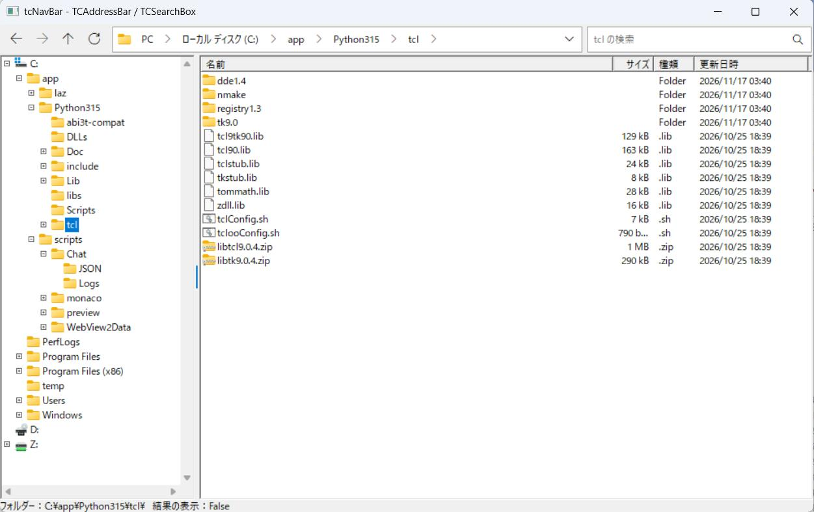

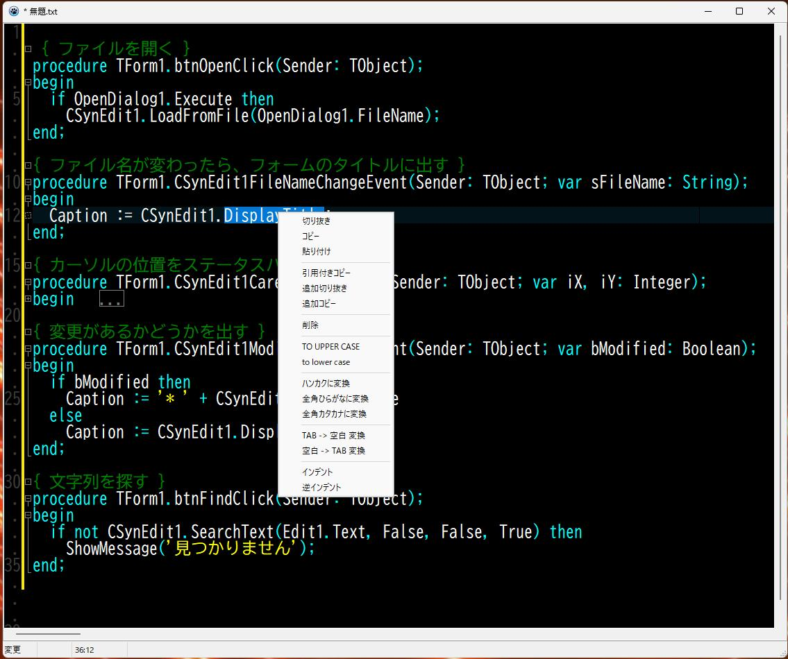

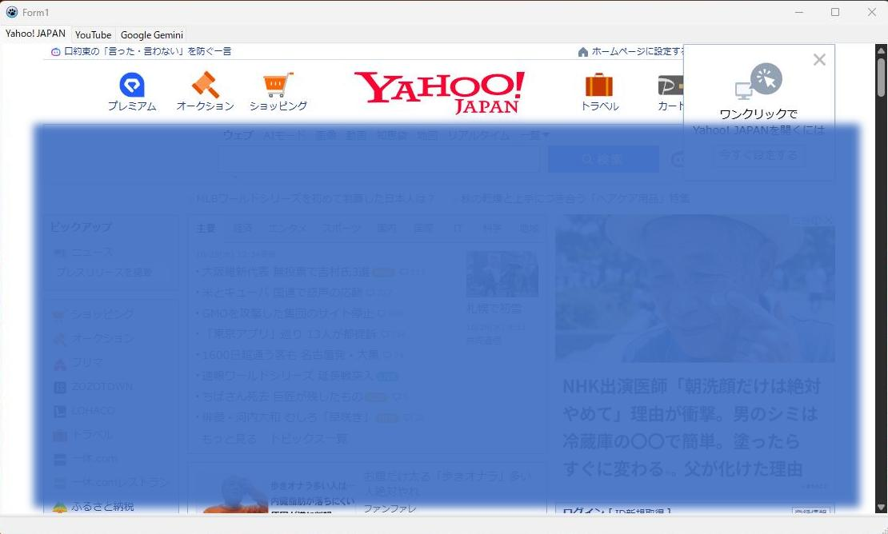

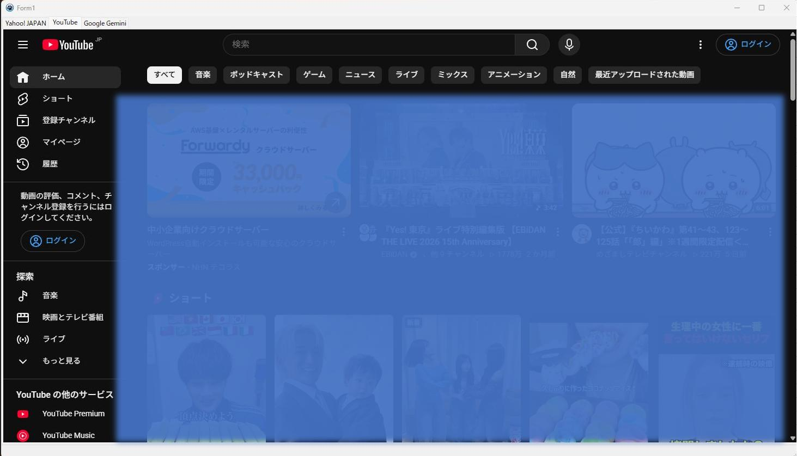

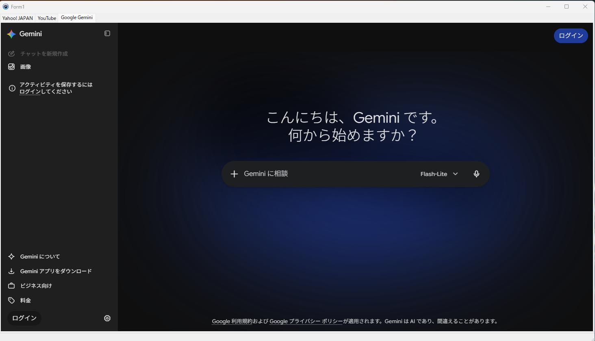

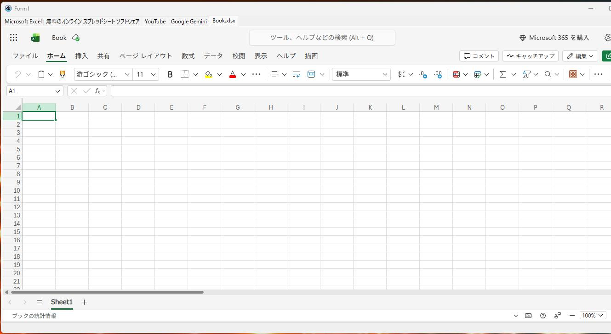

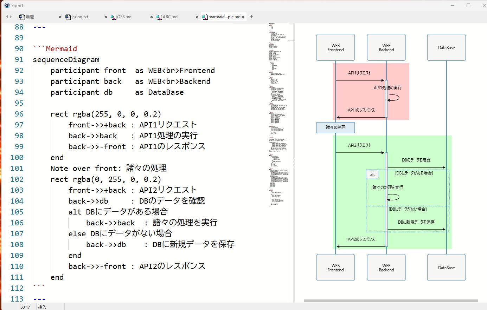

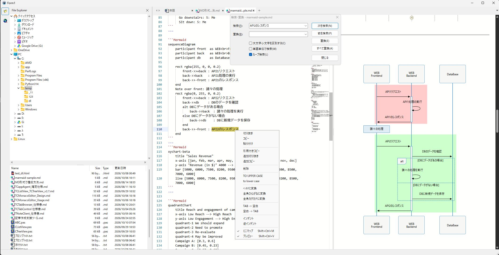

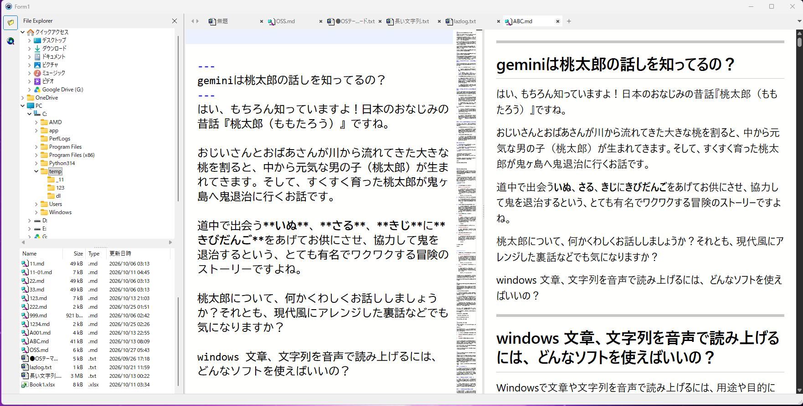

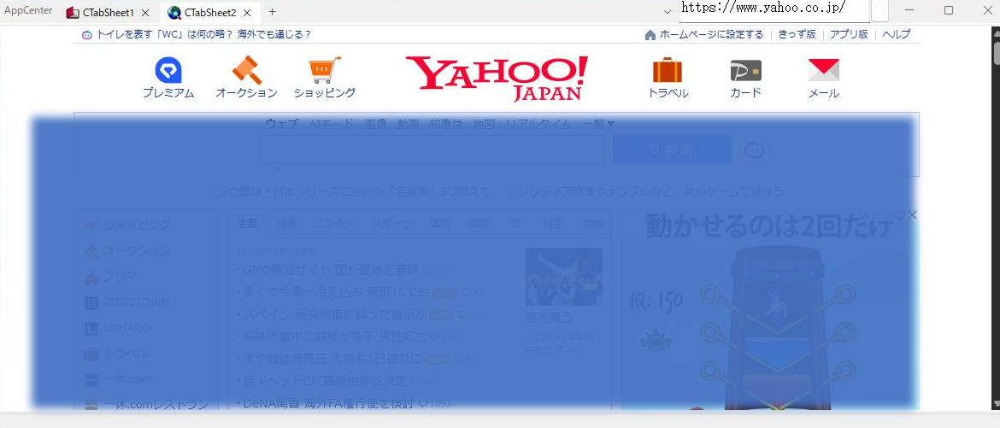

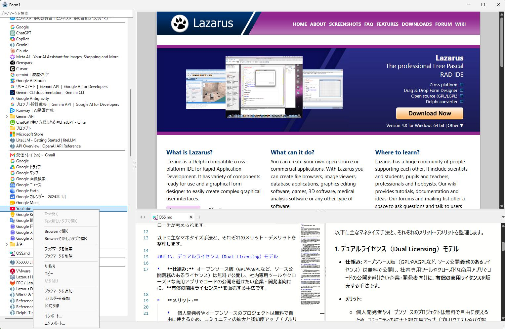

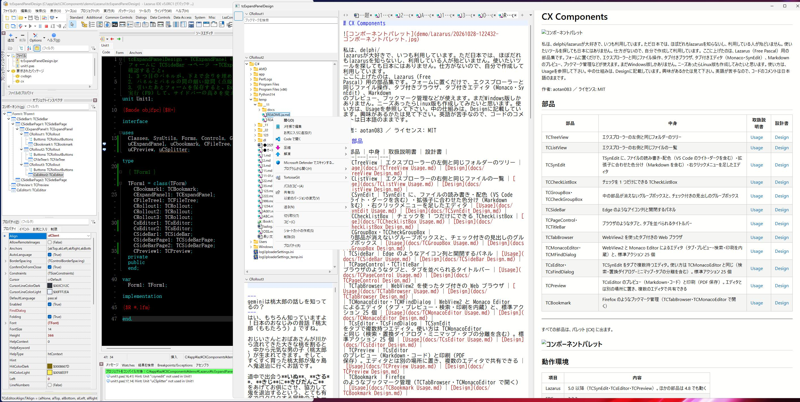

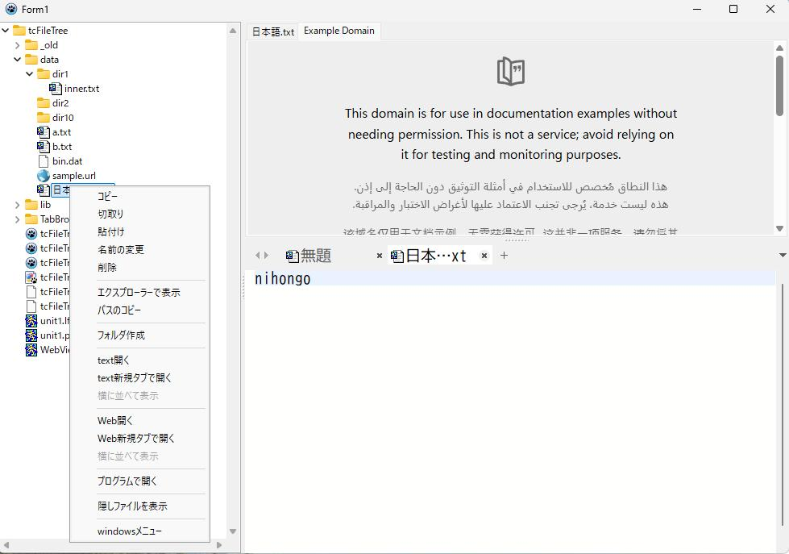

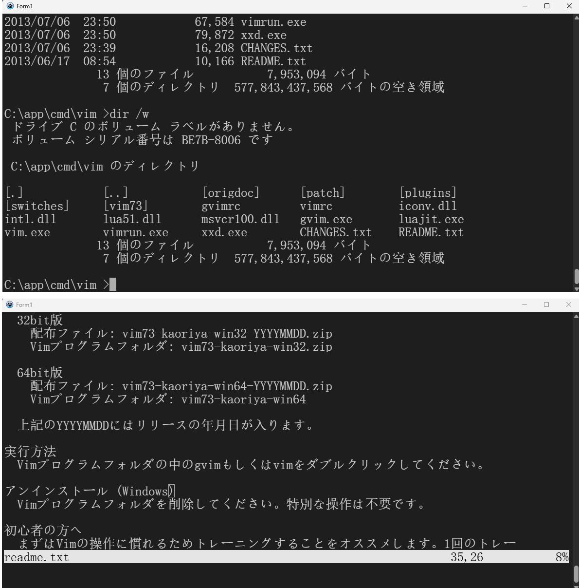


---
