# CX Components

I'm Japanese, so please forgive my poor English!

I love Delphi/Lazarus and use it all the time. However, almost no one in Japan knows about Lazarus, and very few people use it. Even when I search for tools I want to use, they aren't available in Japan. So, I have no choice but to create and use them myself.

What I've listed here is a collection of components for Lazarus (Free Pascal). Simply placing them on a form allows you to use file operations similar to Windows Explorer, a tabbed browser, a tabbed editor (Monaco/SynEdit), Markdown preview, bookmark management, and more. Currently, only a Windows version is available. If there's enough demand, I'd like to create a Linux version as well. Please refer to the Usage section for instructions. The internal workings are described in the Design section. Please take a look if you're interested. Since I'm not good at English, the code comments are in Japanese.

Author: aotan083 / License: MIT

[English Documentation](README.md) | [日本語ドキュメント](README.ja.md)

## Components

| Component | Description | Manual (Japanese) | Design (Japanese) |
|---|---|---|---|
| TCTreeView | Folder tree that works like the left pane of Windows Explorer | [Usage](docs/en/TCTreeView_Usage.md) | [Design](docs/en/TCTreeView_Design.md) |
| TCListView | File list that works like the right pane of Windows Explorer | [Usage](docs/en/TCListView_Usage.md) | [Design](docs/en/TCListView_Design.md) |
| TCSynEdit | TSynEdit with file loading/saving, color styles (including VS Code light/dark), syntax highlighting by file extension (including Markdown) and a context menu | [Usage](docs/en/TCSynEdit_Usage.md) | [Design](docs/en/TCSynEdit_Design.md) |
| TCCheckListBox | TCheckListBox that can be limited to a single check | [Usage](docs/en/TCCheckListBox_Usage.md) | [Design](docs/en/TCCheckListBox_Design.md) |
| TCGroupBox / TCCheckGroupBox | Group box whose child controls never disappear, and a group box with a check box in its caption | [Usage](docs/en/TCGroupBox_Usage.md) | [Design](docs/en/TCGroupBox_Design.md) |
| TCSideBar | Edge-style icon bar with a collapsible panel | [Usage](docs/en/TCSideBar_Usage.md) | [Design](docs/en/TCSideBar_Design.md) |
| TCPageControl / TCTitleBar | Browser-style tabs, and a title bar that can host the tabs | [Usage](docs/en/TCPageControl_Usage.md) | [Design](docs/en/TCPageControl_Design.md) |
| TCTabBrowser | Tabbed web browser based on WebView2 | [Usage](docs/en/TCTabBrowser_Usage.md) | [Design](docs/en/TCTabBrowser_Design.md) |
| TCMonacoEditor / TCMFindDialog | Editor based on WebView2 and Monaco Editor (tabs, preview, search and printing built in), plus 25 standard actions | [Usage](docs/en/TCMonacoEditor_Usage.md) | [Design](docs/en/TCMonacoEditor_Design.md) |
| TCsEditor / TCsFindDialog | Tabbed editor based on TCSynEdit, used the same way as TCMonacoEditor (search/replace dialog, minimap, tab tear-off), plus 25 standard actions | [Usage](docs/en/TCsEditor_Usage.md) | [Design](docs/en/TCsEditor_Design.md) |
| TCPreview | Preview (Markdown / code) and printing (PDF) for TCsEditor, placed separately from the editor and shareable by several editors | [Usage](docs/en/TCPreview_Usage.md) | [Design](docs/en/TCPreview_Design.md) |
| TCBookmark | Firefox-style bookmark manager (opens items in TCTabBrowser / TCMonacoEditor) | [Usage](docs/en/TCBookmark_Usage.md) | [Design](docs/en/TCBookmark_Design.md) |

All components appear on the [CX] palette page. The manuals and design documents are written in Japanese.

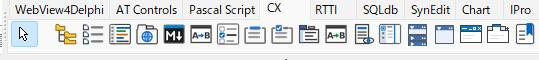


## Requirements

| Item | Version |
|---|---|
| Lazarus | 5.0 or later (TCSynEdit, TCsEditor and TCPreview). The other components also work with 4.8 |
| FPC | 3.2.2 |
| OS | Windows 11 (64-bit) |

## Folders

| Folder | Contents |
|---|---|
| `packages` | `cx.lpk` (run-time package: all components) and `cxdsgn.lpk` (design-time package: palette registration and icons) |
| `source` | Component sources (run-time) |
| `source\design` | Design-time sources (palette registration, component editors) |
| `source\res` | Palette icons (.lrs) |
| `docs` | Manual (`*_Usage.md`) and design document (`*_Design.md`) for each component |
| `runtime` | Files used at run time by the WebView2 components (`monaco`, `preview`) |
| `demo` | Sample programs |

## Installation

1. Install these packages into Lazarus first:
   - WebView4Delphi Lazarus package (https://github.com/salvadordf/WebView4Delphi)
   - ATFlatControls (`atflatcontrols_package`, from the Online Package Manager)
   - SynEdit is included with Lazarus
2. Open `packages\cx.lpk` and click "Compile".
3. Open `packages\cxdsgn.lpk` and click "Install" (the IDE is rebuilt).
4. After the restart, the components appear on the [CX] palette page.

## Using the components in an application

- When you drop a component on a form, `cx` is added to the project's required packages automatically (`cxdsgn` is not needed by applications).
- Nothing needs to be added to the .lpr file.

Applications that use TCTabBrowser, TCMonacoEditor, TCBookmark or TCPreview need these files in the EXE folder:

| File | Description |
|---|---|
| `WebView2.ini` | Required. The values may be empty (empty means the default location in the EXE folder) |
| `WebView2Loader.dll` | 64-bit version, from the WebView4Delphi repository |
| `monaco\` | Editor files for TCMonacoEditor only (`runtime\monaco`; `vs` is `min\vs` of the npm package `monaco-editor`) |
| `preview\` | Preview files for TCMonacoEditor and TCPreview (`runtime\preview`) |

```ini
[WebView2]
LoaderDllPath=
UserDataFolder=
MonacoFolder=
PreviewFolder=
```

| Key | Meaning | When empty |
|---|---|---|
| `LoaderDllPath` | WebView2Loader.dll file | WebView2Loader.dll in the EXE folder |
| `UserDataFolder` | WebView2 user data folder | WebView2Data in the EXE folder |
| `MonacoFolder` | Folder containing `editor.html` and `vs` | monaco in the EXE folder |
| `PreviewFolder` | Folder containing `preview.html` and `lib` | preview in the EXE folder |

- Relative paths are relative to the EXE folder. Several applications can share one `monaco` / `preview` folder.
- The Microsoft Edge WebView2 Runtime is required (it is preinstalled on Windows 11).
- TCsEditor itself needs no run-time files. They are needed only when TCPreview is used.

## License

MIT License (see [LICENSE](LICENSE)). Licenses of third-party libraries are listed in [THIRD_PARTY_NOTICES.md](THIRD_PARTY_NOTICES.md).

---
* demos


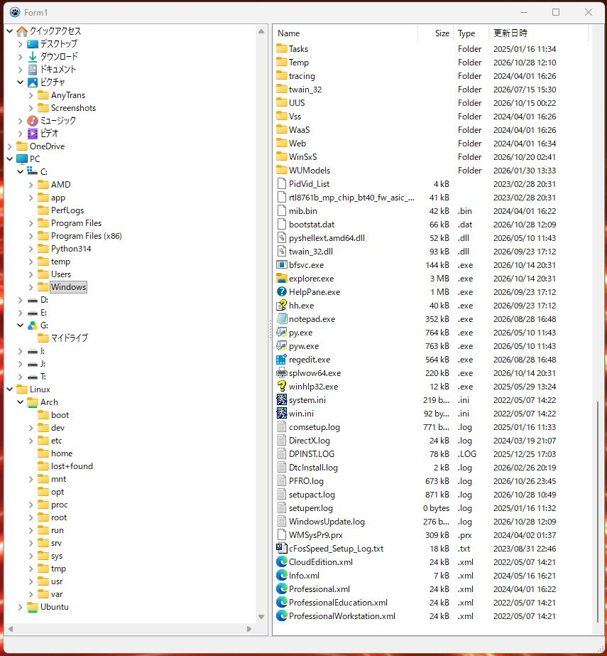

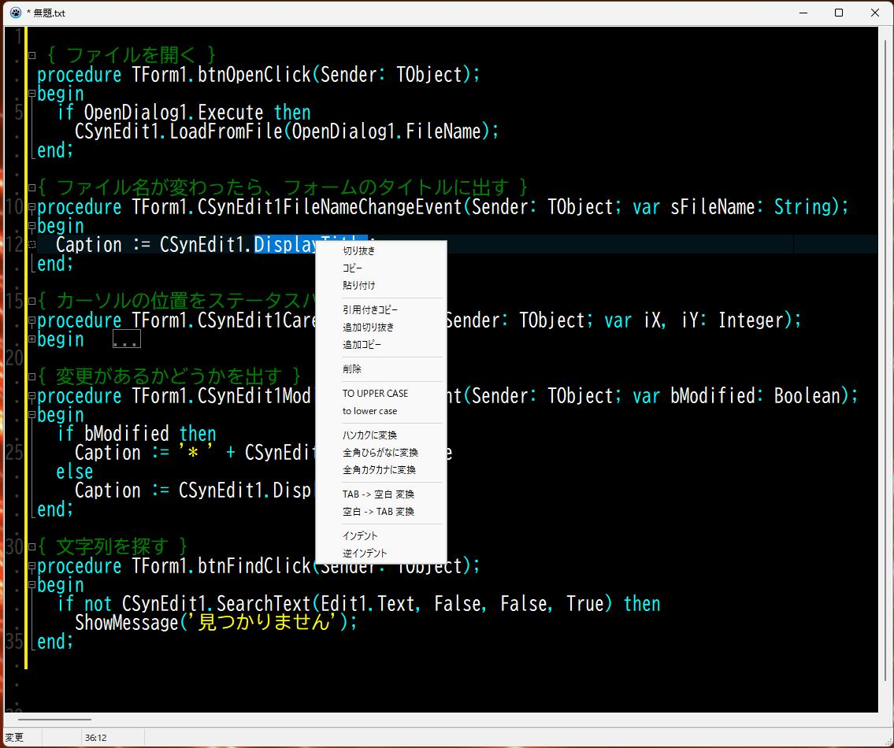

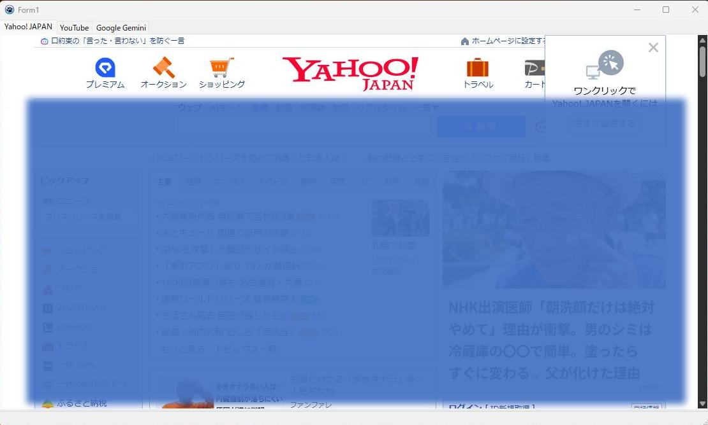

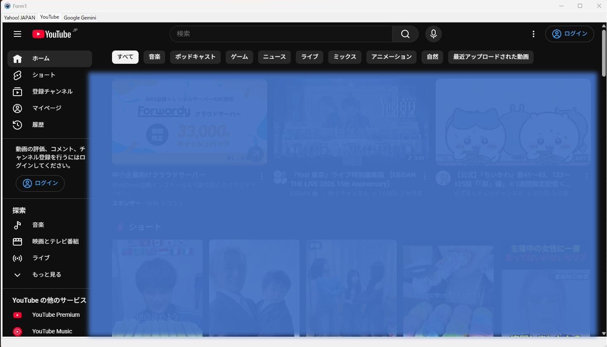

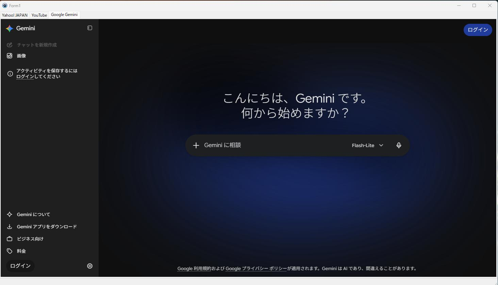

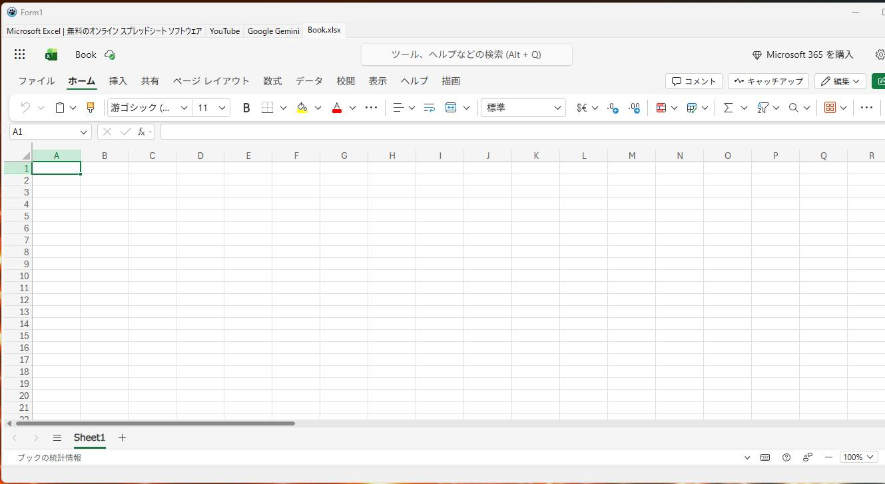

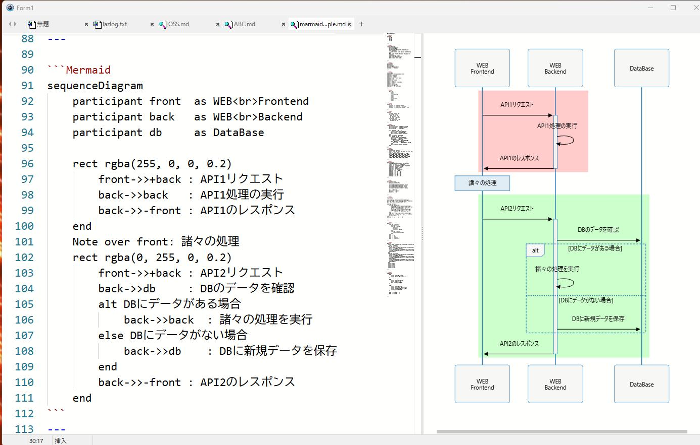

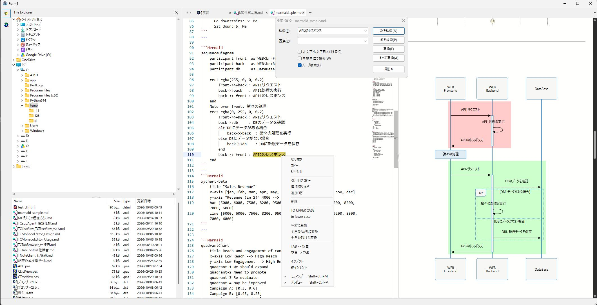

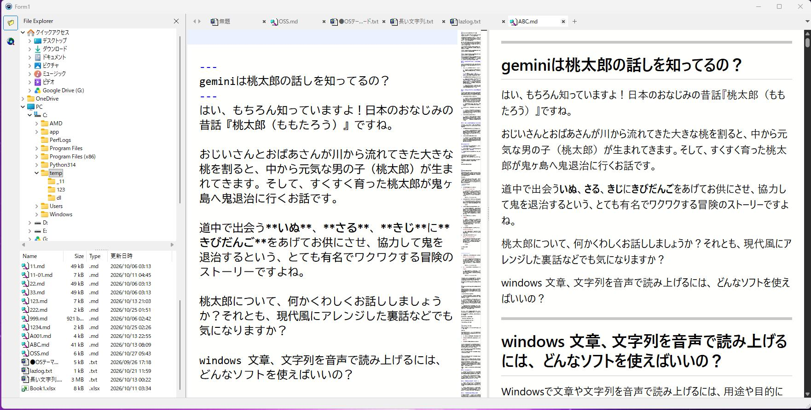

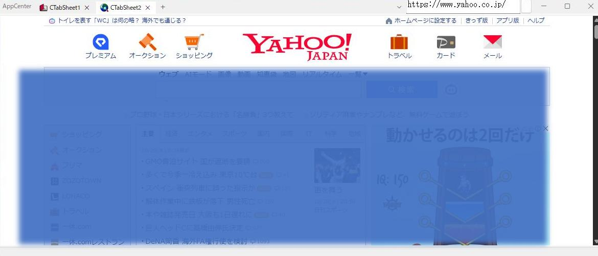

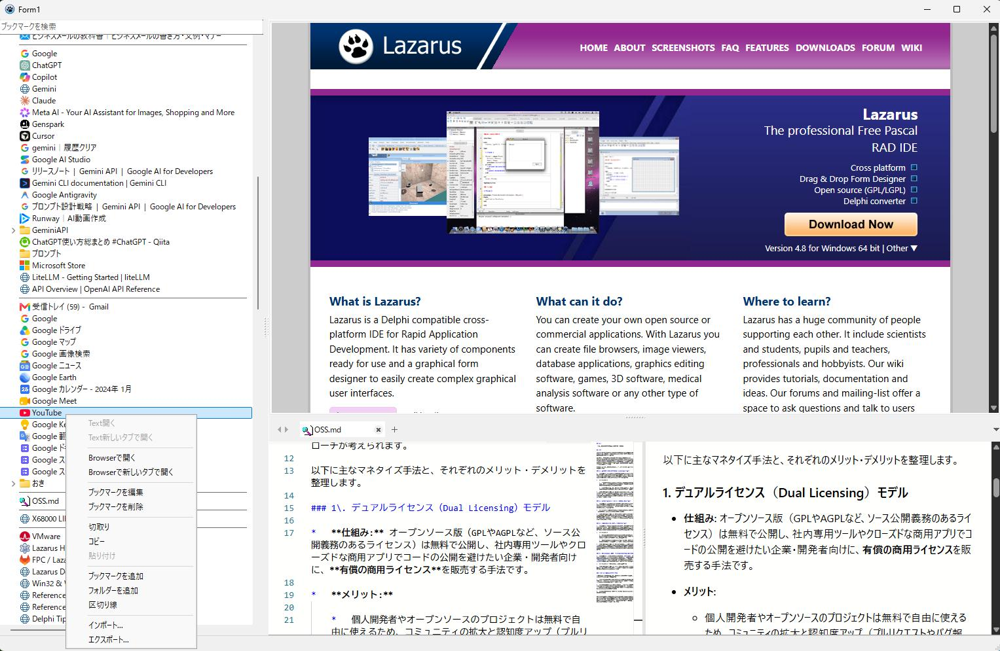

---
